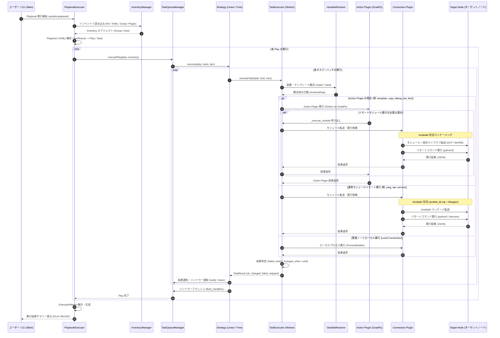
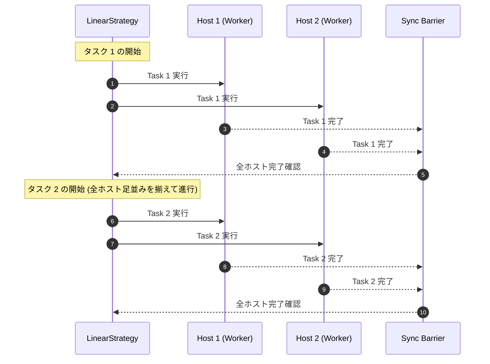
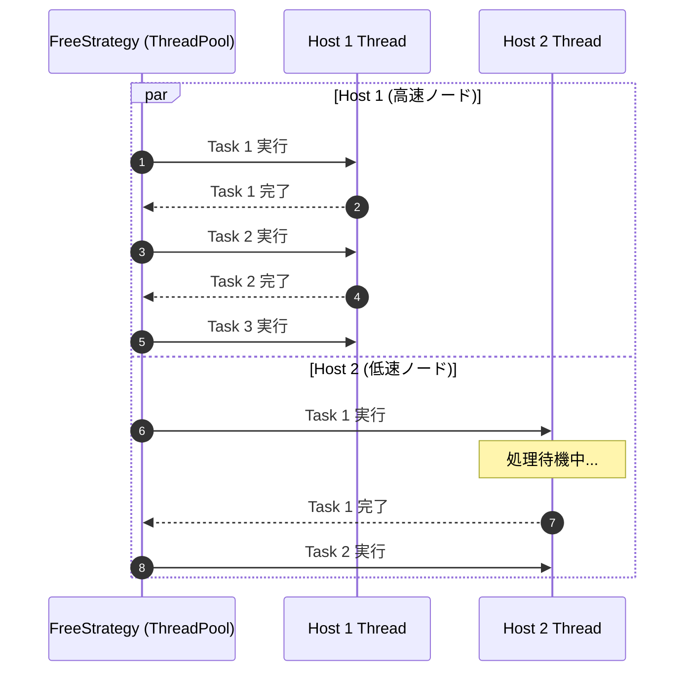
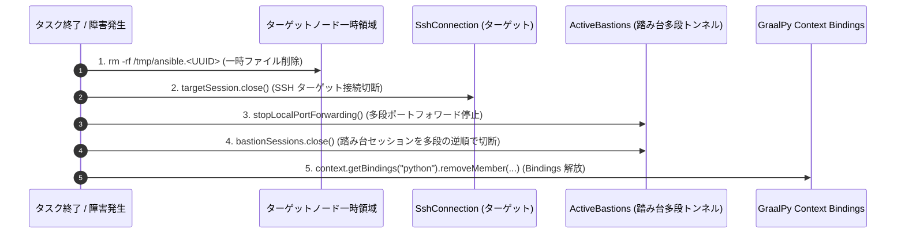

# 処理フロー：AnsibleのPlaybook読み込みから実行まで

本ドキュメントでは、`graal-ansible` における Playbook の読み込み、インベントリ解決、タスクオーケストレーション、および管理ノードからターゲットノードに至る全体的な処理フロー（本プロジェクトの基本設計方針）を定義します。

## 1. 全体処理フロー図 (Overview Sequence)

管理ノード（制御ノード）とターゲットノードの間で行われる Playbook 実行ライフサイクルのシーケンス構造です。



## 2. 7段階の Playbook 実行ライフサイクル (7-Stage Execution Lifecycle)

`graal-ansible` の実行パイプラインは、以下の 7 つの明確なステージを経て完了します。

### 2.1 ステージ 1: CLI 引数解析と実行コンテキスト初期化 (CLI & Context Initialization)
- **入力**: コマンドライン引数 (`String[] args`)、環境変数、システムプロパティ。
- **処理**:
  - `PlaybookCli` (Picocli) により、Playbook パス、インベントリパス (`-i`)、並列度 (`-f` / `--forks`)、接続設定 (`-c` / `-u` / `-k`)、権限昇格フラグ (`-b` / `--become` / `-K`)、チェックモード (`-C` / `--check`)、タグ (`-t` / `--skip-tags`)、および追加変数 (`-e` / `--extra-vars`) を解析。
  - 暗号化パスワード（`--vault-password-file`, `--ask-vault-pass`, `--ask-become-pass`）を解決。コンソールが存在しない非対話環境での安全な例外ハンドリングを実施。
  - 出力先コールバックプラグイン（`DefaultCallback`, `JsonCallback` 等）を `CallbackFactory` 経由で初期化。
- **出力**: `PlaybookCli` インスタンスおよび初期化された `VariableManager` (Level 1 CLI 変数)。

### 2.2 ステージ 2: インベントリ解決とターゲットノード構築 (Inventory Resolution)
- **入力**: インベントリソースパス（単一ファイル、ディレクトリ、スクリプト、またはプラグイン設定）。
- **処理**:
  - `InventoryManager` がソース形式を自動判別し、適切な `InventoryProvider` (`IniInventoryParser`, `YamlInventoryParser`, `ScriptInventoryProvider`, `PythonInventoryProvider`) へディスパッチ。
  - ディレクトリ走査時は、除外ルール（隠しファイル、バックアップファイル、`group_vars`/`host_vars`）を適用し、アルファベット順にソートして処理。
  - 親子グループの階層構造、グループ変数（優先度 3-7）、およびホスト変数（優先度 8-10）を構築。
- **出力**: ターゲットホストおよびグループ変数を内包する `Inventory` オブジェクト。

### 2.3 ステージ 3: Playbook YAML 解析と AST 構築 (Playbook YAML Parsing)
- **入力**: Playbook YAML ファイル、またはタスクリスト YAML。
- **処理**:
  - `YamlParser` (SnakeYAML 2.x) により、YAML 構造を読み込み。独自タグ（`!vault`）を検知し、暗号化メタデータを `VaultDecryptedValue` として保持。
  - Playbook キーワード（`hosts`, `strategy`, `serial`, `roles`, `pre_tasks`, `tasks`, `post_tasks`, `handlers`）を Java Record (`Play`, `Task`, `Role`) へマッピング。
  - `block`, `rescue`, `always` 構造の再帰的パースとディレクティブ継承（`when`, `tags`, `become`, `environment`）の正規化。
- **出力**: 実行可能な `List<Play>` 構造体。

### 2.4 ステージ 4: Play 初期化とターゲットホスト制限 (Play Initialization & Host Filtering)
- **入力**: 単一の `Play` オブジェクトおよび解決済み `Inventory`。
- **処理**:
  - `hosts` パターンおよび `--limit` オプションを `HostPatternParser` で評価（ブラケットを考慮した分割 Bracket-Aware Splitting と範囲パターン展開 Range Pattern Expansion）。
  - ロール（`roles`）のディレクトリ走査と自動ロード（`defaults/main.yml`, `vars/main.yml`, `tasks/main.yml`, `handlers/main.yml`）。
  - 変数ファイル（`vars_files`）のロードとキャッシュ統合。
  - 実行戦略（`LinearStrategy` または `FreeStrategy`）を `StrategyFactory` 経由でインスタンス化。
- **出力**: 対象ホストリスト (`List<Host>`)、登録ハンドラー群、およびタスク実行キュー。

### 2.5 ステージ 5: タスクオーケストレーションと並行制御 (Task Orchestration & Concurrency)
- **入力**: タスクキュー、ホストリスト、および実行戦略。
- **処理**:
  - **セクション順序制御**: `pre_tasks` -> (ハンドラーフラッシュ) -> `roles` / `tasks` -> (ハンドラーフラッシュ) -> `post_tasks` -> (ハンドラーフラッシュ) の順序で実行。
  - **並列性制御**:
    - `LinearStrategy`: 全ホストが同一タスクを完了するまで同期バリアで待機。`serial` 指定時はホスト群をバッチ分割して順次実行。
    - `FreeStrategy`: `ThreadPoolExecutor` (スレッド数: `forks`) を用いてホストごとに独立して並列進行。
  - **失敗許容制御**: `any_errors_fatal` または `max_fail_percentage` の閾値判定を行い、違反時は新規タスク投入を即座に遮断。
- **出力**: 各ホストへの個別タスクディスパッチイベント。

### 2.6 ステージ 6: タスク変数解決とモジュール実行 (Task Execution & Module Dispatch)
- **入力**: 単一タスク (`Task`)、ターゲットホスト (`Host`)、タスク変数コンテキスト。
- **処理**:
  - `when` 条件式の評価（真偽値判定によりスキップ判定）。
  - ループ構造（`loop`, `with_items`）の要素展開と反復実行。
  - Jinja2 テンプレート展開（`VariableResolver`）による最終引数（`resolvedArgs`）および `environment`、`becomeContext` の動的評価。
  - モジュール実行種別の判定（Action Plugin、Ansiballz リモート実行、Local 実行）。
  - 実行結果に対するステータス補正（`failed_when`, `changed_when`）およびリトライループ制御（`until`, `retries`, `delay`）。
- **出力**: 実行結果オブジェクト `TaskResult`。

### 2.7 ステージ 7: 結果集計、ハンドラーフラッシュ、およびレポート生成 (Reporting & Completion)
- **入力**: 全タスクおよびハンドラーの `TaskResult` ストリーム。
- **処理**:
  - `register` キーワードによる変数のホストスコープ登録。
  - `changed=true` の場合、指定されたハンドラー（直接名一致および `listen` トピック）を通知済みキューに登録。
  - フラッシュ境界（セクション終了時または `meta: flush_handlers`）において、重複を排除してハンドラーを実行。`force_handlers` 有効時は失敗ホストに対しても強制フラッシュ。
  - `ExecutionReport` によるホスト別・全体共通メトリクス（ok, changed, unreachable, failed, skipped, total）の集計。
  - コールバックプラグイン（`v2_playbook_on_stats`）による標準出力 PLAY RECAP の出力。
- **出力**: 終了コード（`0`: 正常終了、`2`: タスク失敗、`4`: 接続不能）の返却。

---

## 3. コンポーネント間データ交換インターフェース仕様 (Inter-Component Data Exchange)

各コンポーネント間で受け渡されるデータ構造の型定義と不変性（Immutability）の保証基準です。

| 送信元 -> 送信先 | データモデル / 型 | 主な受渡データ項目 | 不変性 / 可変性 |
| :--- | :--- | :--- | :--- |
| **CLI -> PE** | `PlaybookCli` / コマンド引数 | `playbookPath`, `inventoryPath`, `forks`, `extraVars`, `checkMode` | 不変 (Immutable Record) |
| **IM -> PE / TQM** | `Inventory` | `rootGroup (all)`, ホスト一覧, グループ階層構造 | 内部コレクションは可変 (Mutable) |
| **PE -> TQM** | `Play` | `name`, `hostsPattern`, `tasks`, `handlers`, `strategy`, `serial` | 不変 (Immutable Record) |
| **TQM -> Strategy** | `Play`, `List<Host>`, `TQM` | 対象ホスト群, 登録ハンドラー群, 実行コールバック | 不変 (Immutable Record / Collections) |
| **Strategy -> Worker**| `Task`, `Host`, `Map<String, Object>` | `action`, `args`, `when`, `loop`, `delegateTo`, 22段階解決変数 | 引数 Map はタスク毎に独立生成 |
| **Worker -> Plugin** | `resolvedArgs`, `BecomeContext` | モジュール引数, 昇格設定 (`user`, `flags`, `password`), `environment` | 不変 (Immutable Record / Map) |
| **Plugin -> Worker** | `ConnectionResult` | `exitCode`, `stdout`, `stderr`, `durationMs` | 不変 (Immutable Record) |
| **Worker -> TQM** | `TaskResult` | `taskName`, `action`, `host`, `success`, `changed`, `failed`, `data` | 不変 (Immutable Record) |
| **TQM -> PE** | `ExecutionReport` | ホスト別集計 (ok, changed, failed 等), タスク成否一覧 | 不変 (集計完了後 Immutable) |

---

## 4. 実行戦略別の並行処理フロー (Execution Strategy Concurrency Flow)

### 4.1 Linear 戦略 (LinearStrategy)
デフォルトの実行戦略であり、すべてのターゲットホストが現在のタスクを完了するまで、後続のタスクを開始しません（同期バリア）。

- **同期バリアモデル**:
  - タスク $T_n$ の実行要求が全ホストに対して発行され、全ホストの結果が回収されるまでブロッキング待機します。
  - 特定のホストでタスクが失敗し、`ignore_errors: false` かつリカバリ不可の場合、そのホストは以降のタスク実行対象から除外（失敗ホストとしてマーク）されます。
- **バッチ分割実行 (`serial`)**:
  - `serial: [1, "50%"]` などの指定がある場合、全ホスト群を指定サイズごとのバッチに分割します。
  - 各バッチが完了するごとにハンドラーのフラッシュ（`flush_handlers`）を実施し、成功ホストのみを次バッチへの参照可能変数 `ansible_play_batch` に動的反映します。



### 4.2 Free 戦略 (FreeStrategy)
各ホストが他のホストのタスク進行状況を待たずに、Playbook 内の全タスクを自身のペースで順次実行する並列戦略です。

- **スレッドプール並列実行**:
  - `ThreadPoolExecutor` を使用し、ホストごとに独立したワーカースレッドを割り当てます。
  - 最大並列度は CLI オプション `--forks`（デフォルト: 5）によって制限されます。
- **同時実行数制限 (`throttle`)**:
  - タスクまたは Play レベルで `throttle: N` が指定された場合、`Semaphore(N)` を介して特定タスクの最大同時実行ホスト数をスロットリングします。
- **失敗許容率判定 (`max_fail_percentage`)**:
  - ホストがタスクに失敗する都度、同期的に `checkMaxFailPercentage` を評価します。失敗ホスト割合が閾値を超えた時点で新規タスクのディスパッチを即座に停止します。



---

## 5. モジュール実行モデルの分岐仕様 (Module Execution Dispatch)

タスクの `action` 名および接続タイプに基づき、以下の 3 つの実行モデルに動的に分岐します。

```
[ タスク実行要求 (Worker) ]
          |
          +---> [ Action Plugin に合致するか？ ]
          |       |
          |       +-- (Yes: template, copy, fetch, debug, include_vars, uri 等)
          |       |     |
          |       |     v
          |       |   [ 管理ノード GraalPy 上で Python ActionBase 実行 ]
          |       |     |
          |       |     +--> [ ターゲットへの低レベル指示が必要か？ ]
          |       |            |-- (No)  --> [ 結果を Java TaskResult へ返却 ]
          |       |            +-- (Yes) --> [ Ansiballz リモート実行へ委譲 ]
          |       |
          |       +-- (No)
          v
[ ターゲット接続タイプ (ansible_connection) の判定 ]
          |
          +---> [ local / 制御ノードローカル ]
          |       v
          |     [ LocalConnection: 管理ノードローカルプロセス実行 (ProcessBuilder) ]
          |
          +---> [ ssh / docker / winrm (リモートノード) ]
                  v
                [ Ansiballz リモート転送・実行モデル (Remote Module Execution) ]
```

### 5.1 Action Plugin モデル (Python-first on GraalPy)
- **概要**: 管理ノード上で動作し、ターゲットへの事前準備や動的処理を行います。
- **実行場所**: 管理ノードの GraalPy Polyglot Context。
- **データフロー**:
  - `ansible_action_launcher.py` が呼び出され、Java 側から `task_vars_java`, `connection_java`, `task_executor_java` をバインド。
  - Action Plugin 内部から `_execute_module` が呼び出された場合、Java の `ITaskExecutor` へ再帰的にルーティングされ、後述の Ansiballz モデルによりターゲットノードで実行されます。

### 5.2 Ansiballz リモート転送・実行モデル (Remote Module Execution)
- **概要**: ターゲットノードに Python モジュールと依存ライブラリを転送して実行する標準モデル。
- **実行手順**:
  1. モジュール本体ファイル (`.py`) を探索・特定（`findModuleFile`）。
  2. コア依存ライブラリ (`ansible.module_utils` 等) を集約した `ansible_lib.zip` を動的生成・キャッシュ（`getOrCreateDependencyZip`）。
  3. Base64 符号化引数および JSON パッチを注入したラッパースクリプト `Ansiballz_<module>.py` を動的生成。
  4. ターゲットノードの `/tmp/ansible.<UUID>/` ディレクトリへ転送（`putFile`）。
  5. ターゲットノード上で `python3 /tmp/ansible.<UUID>/Ansiballz_<module>.py` を実行。権限昇格（`becomeContext`）および環境変数を適用。
  6. 標準出力から JSON オブジェクトを抽出し、`finally` で一時ディレクトリを完全削除。

### 5.3 Local 実行モデル (Local Execution)
- **概要**: ターゲットが `localhost` または `connection: local` の場合、管理ノードの OS 上で直接コマンドを実行。
- **実行メカニズム**:
  - `LocalConnection` が `ProcessBuilder` を用いてサブプロセスを起動。
  - `become` 有効時は `sudo -n -H -u <user>` または `su` コマンドでラップし、stdin 経由でパスワードを注入。
  - 非同期ストリームリーダー（`CompletableFuture`）によりデッドロックを防止して出力を収集。

---

## 6. 例外リカバリと逆順リソースクリーンアップライフサイクル (Exception Recovery & Teardown)

タスク実行中に障害が発生した場合、システム全体の整合性を保つための例外リカバリおよびリソース解放ライフサイクルです。

### 6.1 ブロック例外リカバリ (`block` / `rescue` / `always`)
- **障害検知**: `block` セクション内のタスクで例外またはタスク失敗（`failed: true`）が発生した場合、直ちに後続の `block` タスクを中断。
- **障害情報の自動注入**: 失敗タスク情報（`ansible_failed_task`）および実行結果（`ansible_failed_result`）を変数コンテキストに自動登録。
- **リカバリ実行**: `rescue` セクション内の全タスクを順次実行。すべての `rescue` タスクが成功した場合、ブロック全体はリカバリ完了（`failed: false`）として解決。
- **クリーンアップ保証**: `always` セクションは、`block` または `rescue` の成否に関わらず必ず最後に実行。

### 6.2 逆順リソースクリーンアップライフサイクル (Reverse Resource Teardown)
接続や一時ファイルなどのリソースは、障害発生時も含めて確立時と厳密に**逆順（LIFO: Last-In, First-Out）**でクリーンアップされます。



1. **ターゲット一時領域の削除**: モジュール実行完了直後、`finally` ブロックで `/tmp/ansible.<UUID>` を確実に削除。
2. **ターゲット接続のクローズ**: ターゲットノードとの SSH チャンネルおよびセッションを解放。
3. **多段ポートフォワードの停止**: ローカルでバインドされた動的ポートフォワーディングを停止。
4. **多段踏み台セッションの切断**: 接続確立時の逆順（`bastion2` -> `bastion1`）で踏み台 SSH セッションを切断。
5. **Polyglot バインディングの解放**: Java-Python コンテキスト bindings に登録された `complex_args_java` や `connection_java` 参照を破棄し、メモリリークを抑止。

---

## 7. 関連ドキュメント
- [アーキテクチャ設計](../tech/Architecture.md)
- [Playbook 実行仕様](Playbook-Execution.md)
- [タスク実行エンジン](../implementation/Task-Executor.md)
- [タスク制御の実装詳細](../implementation/Task-Control.md)
- [リモートノードでのモジュール実行仕様](../implementation/Remote-Module-Execution.md)
- [エラーハンドリング方針](../tech/Error-Handling-Policy.md)
