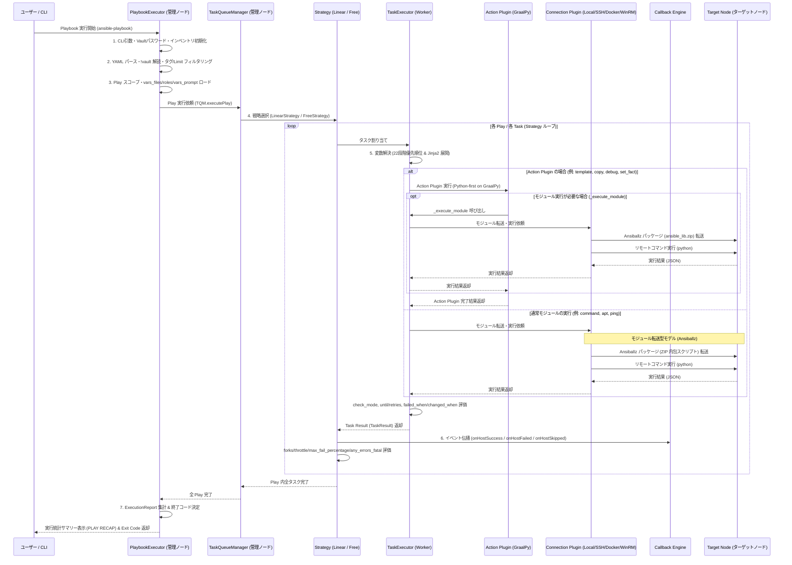

# 処理フロー：AnsibleのPlaybook読み込みから実行まで

本ドキュメントでは、`graal-ansible` における Playbook の読み込みから管理ノードでの変数解決、タスクの並列制御、ターゲットノードでのモジュール実行、コールバック通知、実行レポート生成までの完全な処理フローと各コンポーネント間の連携仕様を詳述します。

## 1. 全体アーキテクチャフロー図

以下のシーケンス図は、管理ノード（制御ノード）とターゲットノードの間で行われる処理の流れを示しています。

## 2. ライフサイクル実行フェーズ (7段階)

`graal-ansible` の処理ライフサイクルは、以下の明確に分離された 7 つのフェーズに従って順番に実行されます。

### 2.1 フェーズ 1: CLI および実行環境の初期化 (CLI & Environment Initialization)

1.  **CLI 引数のパース**: `PlaybookCli` において `Picocli` 4.7.5 を使用してコマンドライン引数（`-i`, `-e`, `-f`, `-c`, `-b`, `-C`, `-t`, `-l`, `--force-handlers`, `--vault-password-file`, `--vault-id` 等）を解析します。
2.  **設定ファイルロード**: `ANSIBLE_CONFIG` 環境変数またはカレントディレクトリ / ホームディレクトリ配下の `ansible.cfg` を読み込み、`stdout_callback` や `forks` デフォルト値を決定します。
3.  **Vault パスワード解決**: `--vault-password-file`, `--vault-id`, または環境変数 `ANSIBLE_VAULT_PASSWORD_FILE` から暗号化鍵を読み込み、必要に応じて `ConsolePromptProvider` によるインタラクティブプロンプトを表示して `VaultSecretStore` に保持します。
4.  **インベントリの構築**: `InventoryManager` を介して指定されたインベントリ（静的 INI/YAML ファイル、動的外部スクリプト、Python インベントリプラグイン、またはディレクトリ構造）を自動判別し、グループ変数およびホスト変数を階層的に読み込んで `Inventory` オブジェクトを構築します。

### 2.2 フェーズ 2: Playbook 解析とタスク・ホストフィルタリング (Parsing & Filtering)

1.  **YAML 解析**: `YamlParser` が `SnakeYAML` 2.x を使用して YAML ファイルを読み込み、Java Record オブジェクト（`Play`, `Task`）へマッピングします。
2.  **!vault タグの解析**: SnakeYAML のカスタムコンストラクタ `ConstructVault` が `!vault` タグを検知し、暗号化テキストを未復号のまま `VaultDecryptedValue` ラッパーオブジェクトとして保持します。
3.  **タグフィルタリング**: `--tags`（`-t`）および `--skip-tags` オプションに基づき、`isTaskToBeExecuted` アルゴリズムを実行します。`always` および `never` 特殊タグの評価、ならびに `block`, `rescue`, `always` 内のネストタスクに対する再帰的スキャンを実施して実行対象タスクを決定します。
4.  **ホストフィルタリング (Limit)**: `--limit`（`-l`）オプションで指定されたホストパターンを `HostPatternParser` で解析し、Play の `hosts` ディレクティブで抽出されたホスト集合から最終的なターゲットホスト群に絞り込みます。

### 2.3 フェーズ 3: Play スコープと 22 段階変数階層の構築 (Play Scope & Variable Setup)

1.  **インタラクティブプロンプトの収集 (`vars_prompt`)**: `Play` レコードに `vars_prompt` が定義されている場合、`ConsolePromptProvider` 経由でユーザーから対話入力を取得し、Level 13 (Play `vars_prompt`) 変数として登録します（より高優先度の `extra-vars` で定義済みの場合はスキップ）。
2.  **静的変数ファイルの読み込み (`vars_files`)**: `vars_files` ディレクティブに指定された `.yml` / `.json` ファイルを `varsFileCache` を用いて読み込み、Level 14 (Play `vars_files`) 変数として組み込みます。
3.  **ロールの事前ロード (`roles`)**: Play レベルで定義された `roles` に基づき、`roles/<role_name>/defaults/main.yml`（Level 2）および `roles/<role_name>/vars/main.yml`（Level 15）を自動ロードします。
4.  **22 段階優先順位の統合**: `VariableManager` が CLI `extra-vars`（Level 22）、Play 変数（Level 12）、Host 変数（Level 9）、Group 変数（Level 4-7）などを集約し、[変数優先順位](../implementation/Variables-Templating.md#2-変数優先順位-variable-precedence) に基づく評価コンテキストを構築します。

### 2.4 フェーズ 4: 実行戦略と並列ループ制御 (Strategy Selection & Parallel Loop)

1.  **戦略の動的選択**: `StrategyFactory` が Play の `strategy` キーワード（`linear` または `free`）に基づき、対応する `Strategy` インスタンス（`LinearStrategy` または `FreeStrategy`）を生成します。
2.  **バッチ分割 (`serial`)**: `LinearStrategy` の場合、`serial` 設定（数値、パーセンテージ、またはリスト形式）に従ってターゲットホスト群を複数バッチに分割し、バッチ単位でタスクループを実行します。
3.  **スレッドプール並列制御 (`forks` / `throttle`)**:
    - **`forks`**: `-f` / `--forks` で指定されたスレッド数を持つ `ThreadPoolExecutor` を初期化し、複数ホストの並列実行を行います。
    - **`throttle`**: タスク / ブロック / Play レベルの `throttle` 設定に基づき、`FreeStrategy` 内の `Semaphore` を用いて同時実行ホスト数を制限します。
4.  **動的エラー監視 (`max_fail_percentage` / `any_errors_fatal`)**:
    - 各タスク完了直後に `checkMaxFailPercentage` を実行し、失敗率が閾値を超えた場合に即座に Play を中断します。
    - `any_errors_fatal: true` が有効な場合、単一ホストの失敗発生時に `playFatalError` フラグをセットして全ホストの実行を直ちに停止します。

### 2.5 フェーズ 5: タスク評価・Action/Module 実行メカニズム (Task Execution)

1.  **Jinja2 テンプレート展開**: `TaskExecutor` (Worker) が `VariableResolver` を呼び出し、タスク引数内の Jinja2 テンプレート式を展開します。単一式の場合は型保持評価（Raw Type Preservation）を行い、27 種類の Jinja2 フィルターおよび 7 種類の Lookup プラグイン（`file`, `env`, `template` 等）を実行します。
2.  **Action Plugin の実行**: 実行対象が Action Plugin（`copy`, `template`, `debug`, `set_fact` 等）の場合、`ansible_action_launcher.py` を解して GraalPy 上でオリジナルの Python 製 Action Plugin を直接実行します（Python-first 方式）。必要に応じて Action Plugin 内部から `_execute_module` を呼び出します。
3.  **通常モジュールの転送・実行 (Ansiballz)**:
    - 実行対象が通常モジュール（`command`, `ping`, `apt` 等）の場合、モジュール本体と `ansible.module_utils` 依存コードを `ansible_lib.zip` パッケージとしてバンドルします。
    - 選択された `ConnectionPlugin`（`LocalConnection`, `SshConnection`, `DockerConnection`, `WinRMConnection`）を介してターゲットノードへ転送し、リモートの Python インタプリタで実行して JSON 出力を回収します。
4.  **コンテキスト制御と結果判定**:
    - **`check_mode`**: `-C` 指定時またはタスク固有の `check_mode` 設定に基づき、モジュール引数へ `_ansible_check_mode: true` を自動注入します。
    - **`environment`**: **Task > Block > Play** 優先順序で評価された環境変数 Map を接続プラグインへ伝播します。
    - **`until` / `retries` / `delay`**: リトライループ条件を評価し、成功または最大試行回数に達するまで繰り返し実行します。
    - **`failed_when` / `changed_when`**: モジュール返却ステータスを動的な条件式評価で上書き補正し、最終的な `TaskResult` を決定します。

### 2.6 フェーズ 6: イベント伝播とコールバックプラグインライフサイクル (Callback Lifecycle)

1.  **コールバックの解決**: `CallbackFactory` が優先順位（`ANSIBLE_STDOUT_CALLBACK` 環境変数 > `ansible.cfg` の `stdout_callback` > デフォルト `default`）に従って最適なコールバックプラグイン（`DefaultCallback`, `MinimalCallback`, `YamlCallback`, または `PythonCallback`）を解決します。
2.  **イベント通知**: 実行の各局面で以下のイベントフックを呼び出します：
    - `onPlaybookStart(playbook)` / `onPlayStart(play)` / `onTaskStart(task)`
    - `onHostSuccess(host, taskResult)` / `onHostFailed(host, taskResult)` / `onHostSkipped(host, taskResult)` / `onHostUnreachable(host, exception)`
3.  **重複排除とスレッドセーフ**: `DefaultCallback` は `synchronized` メソッドと `ConcurrentHashMap` 重複排除ロジックを備えており、`FreeStrategy` 等の並列実行時における標準出力の混在やヘッダー出力を防止します。

### 2.7 フェーズ 7: 実行レポート生成と終了コードマッピング (Report & Exit Codes)

1.  **統計情報の集計 (`ExecutionReport`)**: 全 Play の実行完了後、`PlaybookExecutor` は `ExecutionReport` を生成し、ホスト別および全体共通の実行統計（`ok`, `changed`, `unreachable`, `failed`, `skipped`, `total_tasks`）を集計します。
2.  **終了コード (Exit Code) の評価**: `PlaybookCli` は `ExecutionReport.isSuccess()` および発生した例外種別に基づき、[CLI 仕様](CLI-Specification.md#7-終了コード-exit-code) に定義された標準終了コードを返却します：
    - **`0`**: 全タスクが正常に実行完了（Success）。
    - **`2`**: 1 つ以上のターゲットホストでタスク実行失敗または接続不能（Host Failure / Unreachable）。
    - **`4`**: YAML 構文エラーまたは Playbook 解析失敗（Syntax Error）。
    - **`1`**: その他の一般的なランタイム例外（General Error）。

## 3. コンポーネント間データ交換インターフェース仕様

各フェーズでコンポーネント間を流通する主要なデータオブジェクトと転送パラメータの一覧です。

| 送信元コンポーネント | 受信先コンポーネント | 呼び出し API / データオブジェクト | 伝播されるデータ項目 |
| :--- | :--- | :--- | :--- |
| `PlaybookCli` | `PlaybookExecutor` | `execute(playbookPath, extraVars)` | CLI オプションマップ、Vault パスワードストア、インベントリパス |
| `YamlParser` | `PlaybookExecutor` | `List<Play>` Records | Playbook 定義、Play/Task 階層構造、!vault 暗号化参照 |
| `PlaybookExecutor` | `TaskQueueManager` | `executePlay(play, inventory)` | 解決済み Play スコープ、ターゲットホスト群、変数優先順位コンテキスト |
| `TaskQueueManager` | `Strategy` | `run(play, hosts, taskQueue)` | 実行戦略設定 (`serial`, `forks`, `throttle`, `max_fail_percentage`) |
| `Strategy` | `TaskExecutor` (Worker) | `executeTaskOnHost(host, task)` | 単一タスク定義、対象ホスト情報、アクティブロールスタック |
| `TaskExecutor` | `VariableResolver` | `resolve(template, variables)` | 未評価 Jinja2 式、22 段階全変数マップ、カスタムフィルター/Lookup |
| `TaskExecutor` | `ActionPlugin` (GraalPy) | `run(task_vars, connection)` | Java-Python バインディングコンテキスト、`_execute_module` 参照 |
| `TaskExecutor` | `ConnectionPlugin` | `execCommand(cmd, become, env)` | 評価済み CLI コマンド、`BecomeContext`、タスク環境変数 Map |
| `ConnectionPlugin` | `Target Node` | Ansiballz ZIP / SSH Exec | パッケージ化モジュール、stdin 注入パスワード、実行環境変数 |
| `TaskExecutor` | `Callback` | `onHostXxx(host, taskResult)` | ホスト名、`TaskResult`（`changed`, `failed`, `stdout`, `msg` 等） |
| `PlaybookExecutor` | `PlaybookCli` | `ExecutionReport` | ホスト別メトリクス、`isSuccess()` 判定、全体統計サマリー |

## 4. 各コンポーネントの役割

### 4.1 管理ノード (Control Node) で実行されるコンポーネント

*   **`PlaybookExecutor`**: Playbook 全体のライフサイクル管理、レポート集計、および例外ハンドリングを担当。
*   **`TaskQueueManager (TQM)`**: ターゲットホストへのタスク配信、ハンドラーフラッシュ境界管理、エラー時リカバリを制御。
*   **`Strategy` (Linear / Free)**: タスク実行順序、バッチ分割（`serial`）、並列度（`forks` / `throttle`）、早期中断条件の制御。
*   **`TaskExecutor` (Worker Process)**: 単一タスクの評価、Jinja2 テンプレート展開、`until` リトライ、結果カスタマイズを実施。
*   **`Action Plugin` (GraalPy)**: 管理ノード上での制御ロジック実行（`copy`, `template`, `debug` 等）。本家 Python ソースをそのまま動作させる Python-first 方式を採用。
*   **`Connection Plugin` (Local / SSH / Docker / WinRM)**: ターゲットノードに対する認証、コマンド実行、Base64/SCP/`docker cp` ファイル転送の抽象化。
*   **`Callback` (Default / Minimal / Yaml / Python)**: 実行イベントを受信し、リアルタイムのログ出力および標準フォーマット整形を担当。

### 4.2 ターゲットノード (Target Node) で実行されるコンポーネント

*   **`Ansible Module`**: 管理ノードから転送された Ansiballz パッケージ（Python スクリプト + `ansible.module_utils`）をターゲット上の Python で実行し、結果を JSON 形式で標準出力に返却。
*   **`Python ランタイム`**: 転送された Ansiballz パッケージを解凍・実行するためのターゲット側実行環境。

## 5. モジュール転送型実行モデル (Ansiballz)

Ansible の「エージェントレス」アーキテクチャを実現するため、以下の 5 ステップに従ってリモート実行が行われます。

1.  **依存ライブラリのパッキング (Ansiballz)**: 実行対象モジュール（例: `ansible.builtin.apt`）と依存する `ansible.module_utils` 共通モジュール群をメモリ上で `ansible_lib.zip` にアーカイブし、ブートストラップ用ラッパー Python スクリプトを生成します。
2.  **一時実行ディレクトリの作成**: `ConnectionPlugin` を経由して、ターゲットノード上に安全なパーミッションを持つ一時ディレクトリ（例: `~/.ansible/tmp/ansible-tmp-<timestamp>/`）を作成します。
3.  **転送**: パッケージ化されたラッパースクリプトおよび ZIP ファイルをターゲットノードの一時ディレクトリへ転送します。
4.  **リモート実行**: ターゲットノード上の Python インタプリタを呼び出し、権限昇格（`sudo`/`su`/`runas`）が必要な場合はプロンプト処理と stdin パスワード注入を行った上でスクリプトを実行します。実行結果は標準出力に JSON 文字列として出力されます。
5.  **結果回収とクリーンアップ**: 管理ノードが標準出力から JSON 文字列を読み取って `parseModuleOutput` で解析し、ターゲットノード上の一時ディレクトリと転送ファイルを削除（クリーンアップ）します。

## 6. 例外処理・リカバリとリソース解放フロー

1.  **タスク失敗時の `block` / `rescue` / `always` リカバリ**:
    - `block` 内でタスクが失敗すると、実行エンジンは自動的に `ansible_failed_task` および `ansible_failed_result` 変数を注入し、`rescue` セクションへ遷移します。
    - `rescue` 内の全タスクが成功した場合、ブロック全体の失敗ステータスがリカバリ（`failed=false`）され、Playbook 実行が継続されます。
    - `always` セクションは成否に関わらず必ず最後に実行されます。
2.  **多段 SSH カスケードクローズ (Reverse Teardown)**:
    - 多段 Bastion / Jump Host 経由の SSH 接続（`SshConnection`）終了時、ターゲットセッション -> ローカルポートフォワード停止 -> 各 Bastion セッションの順で、構築時と逆順（Reverse Teardown）に安全にソケット・チャネルを解放します。
3.  **並列スレッドプールと非同期ジョブのシャットダウン**:
    - `FreeStrategy` の `ThreadPoolExecutor` や非同期ジョブ用スレッドプール（`DefaultAsyncJobManager`）は、実行完了時または例外スロー時に `shutdown()` および `awaitTermination` を呼び出してスレッドリークを完全に防止します。
