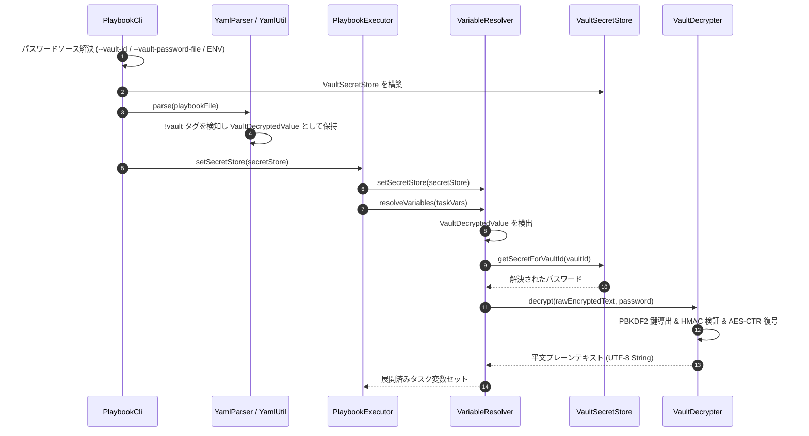

# Ansible Vault 復号・暗号化仕様 (Ansible Vault Decryption & Encryption Specification)

本ドキュメントでは、`graal-ansible` における Ansible Vault 暗号化データ（暗号化ファイルおよびインラインの `!vault` 独自タグ）を Java でネイティブに復号・暗号化し、Playbook 実行エンジンへ透明に統合するための機能仕様およびアーキテクチャ設計について定義します。

## 1. 概要 (Overview)

Ansible Vault は、機密情報（パスワード、APIキー、秘密鍵、トークンなど）を AES-256-CTR 暗号で保護して Git リポジトリ等に安全に保管するための仕組みです。`graal-ansible` では、YAML 解析時に `!vault` タグをエラーなく透過的にパースするだけでなく、値自体のネイティブ復号およびプレーンテキストの暗号化に対応しています。

本機能は、外部の Python プロセスや GraalPy インタプリタを介さず、Java の標準暗号ライブラリ（`javax.crypto`）を用いて安全かつ高速にネイティブ復号・暗号化を実行する仕組みを導入したものです。これにより、プレイブック実行時における機密データの自動展開および複数 Vault ID による安全な暗号管理を実現しています。

- **対応 Vault フォーマット**: Vault 1.1 および 1.2（`$ANSIBLE_VAULT;1.1;AES256`, `$ANSIBLE_VAULT;1.2;AES256;vault-id`）。
- **遅延評価 (Lazy Evaluation)**: SnakeYAML 解析時には暗号化データを値オブジェクトとしてパースし、実際の変数評価フェーズで必要になったタイミングで動的に復号します。
- **マルチ Vault ID 対応**: 複数の `--vault-id` / パスワード指定に対応し、`VaultSecretStore` による ID マッチングおよびフォールバック復号を実現します。

## 2. 暗号仕様と復号・暗号化アルゴリズム (Cryptographic Specifications)

Ansible Vault (Vault フォーマット 1.1 および 1.2) で使用される標準的な暗号化アルゴリズム、ペイロード構造、鍵生成手順、および PKCS#7 アライメント処理の詳細は以下の通りです。

### 2.1 暗号化フォーマットとヘッダー識別
暗号化されたデータ（または YAML 値）は、以下のヘッダーから始まるテキスト形式です。
- **1.1 フォーマット**:
  ```text
  $ANSIBLE_VAULT;1.1;AES256
  ```
- **1.2 フォーマット（Vault ID ラベル付き）**:
  ```text
  $ANSIBLE_VAULT;1.2;AES256;dev_vault
  ```

ヘッダー要素はセミコロン（`;`）で分割され、マジック文字列（`$ANSIBLE_VAULT`）、バージョン（`1.1` または `1.2`）、暗号アルゴリズム（`AES256`）、および Vault ID ラベル（1.2 形式のみ）が順に検証されます。

### 2.2 二重ヘキサ（Outer / Inner Hex）エンコードと 80 文字改行ラップ
ペイロードのシリアライズおよびデコードは、以下の二重ヘキサ構造に従って処理されます。

1. **アウター（外側）ヘキサデコード**:
   - ヘッダー行以降のテキストから全改行文字（`\n`, `\r\n`）および空白を除去し、1 つの連続したヘキサ文字列に結合します。
   - このヘキサ文字列をバイト配列にデコード（16進数 2 文字 -> 1 バイト）すると、UTF-8 エンコードされたインナーテキスト（中間文字列）が得られます。
2. **インナー（内側）テキスト分離**:
   - インナーテキストを改行文字（`\n`）で分割すると、以下の 3 つのヘキサエンコードされたフィールドが抽出されます。
     - **ソルト (Salt)**: 32 バイトのランダム値（64 文字のヘキサ文字列）
     - **HMAC 署名**: 32 バイトの HMAC-SHA256 署名（64 文字のヘキサ文字列）
     - **暗号文 (Ciphertext)**: AES 暗号化データ（偶数長のヘキサ文字列）
3. **アウターヘキサエンコードおよび 80 文字ラップ (暗号化時)**:
   - 暗号化時には、インナーテキスト（`salt_hex + "\n" + hmac_hex + "\n" + cipher_hex`）を UTF-8 バイト列に変換した後、アウターヘキサ文字列へ変換します。
   - 可読性と git diff 互換のため、アウターヘキサ文字列を 80 文字ごとに改行（`\n`）で区切ってフォーマットします。

### 2.3 鍵誘導 (Key Derivation - PBKDF2)
ソルトのバイト配列（32 バイト）と、ユーザーから入力された Vault パスワードを用いて、**PBKDF2 (Password-Based Key Derivation Function 2)** により 80 バイトのキーを導出します。

- **擬似ランダム関数 (PRF)**: `PBKDF2WithHmacSHA256`
- **イテレーション数 (c)**: `10000` 回
- **導出キー長 (dkLen)**: `80` バイト (640 ビット)
- **キーの分割配置**:
  - 導出された 80 バイトの配列は、バイト位置によって以下のように正確に3分割され、それぞれの暗号処理に適用されます。

| 領域 | バイトインデックス | 長さ | 用途 |
| :--- | :--- | :--- | :--- |
| **AES 復号鍵 (AES Key)** | `0` ～ `31` | 32 バイト (256 bits) | AES-256 対称暗号鍵 |
| **HMAC 検証鍵 (HMAC Key)** | `32` ～ `63` | 32 バイト (256 bits) | HMAC-SHA256 署名生成・検証鍵 |
| **初期化ベクトル (IV / Counter Nonce)** | `64` ～ `79` | 16 バイト (128 bits) | AES-CTR カウンター初期化ベクトル |

### 2.4 暗号モードと整合性検証 (AES-CTR & HMAC)
- **整合性検証 (HMAC-SHA256)**:
  - 復号を行う前に、導出した HMAC 検証鍵（32 バイト）を用いて、抽出した暗号文の生バイト配列（ヘキサデコード後）に対する HMAC-SHA256 署名を算出します。
  - 算出された署名値が、インナーデコードで抽出した HMAC 署名の生バイト配列と完全に一致するかをバイト単位で検証します。比較には定数時間比較 (`MessageDigest.isEqual`) を使用します。
  - 署名が一致しない場合は、パスワード誤りまたはデータの破損（改ざん）と判断し、`VaultDecryptionException` をスローして即座に処理を中断します。
- **対称暗号 (AES-256-CTR)**:
  - 整合性検証をクリアした後、導出した AES 復号鍵（32 バイト）および初期化ベクトル（16 バイト）を使用し、**AES/CTR/NoPadding** モードで暗号文の復号（または暗号化）を行います。
- **PKCS#7 パディング**:
  - AES-CTR はストリーム暗号として動作するため本質的にパディングは不要ですが、Ansible Vault の仕様上、暗号化される前のプレーンテキストデータはあらかじめ **PKCS#7 方式** で 16 バイトのブロックサイズにアライメントパディングされます。
  - **アンパディング規則**: 復号後のバイト配列の末尾バイト `N = data[data.length - 1]` (1 <= N <= 16) を読み取り、末尾 `N` バイトがすべて値 `N` であることを確認して除去します。不正なパディング値が検出された場合は例外をスローします。
  - **パディング規則 (暗号化時)**: プレーンテキストの長さ `len` に対し、パディングバイト数 `padLen = 16 - (len % 16)` を計算し、値 `padLen` を持つバイトを末尾に `padLen` 回追加してから AES-CTR 暗号化を行います。

### 2.5 具体的な復号アルゴリズム手順
1. 暗号化テキストのヘッダー行（`$ANSIBLE_VAULT;...`）を識別し、フォーマットバージョンとラベル（存在する場合）を解析する。
2. 以降の行から改行（`\n`、`\r\n`）を取り除き、結合して1つのフラットなヘキサ文字列を構築する。
3. 構築したアウターヘキサ文字列をバイト配列にデコードし、UTF-8 文字列（インナーテキスト）として解釈する。
4. インナーテキストを改行文字（`\n`）で分割し、3つの要素（ソルト、HMAC、暗号文）のヘキサ文字列を抽出する。
5. 3つのヘキサ文字列をそれぞれデコードし、生バイト配列（生ソルト: 32 bytes, 生HMAC: 32 bytes, 生暗号文: N bytes）を得る。
6. 生ソルトと Vault パスワードを用いて `PBKDF2WithHmacSHA256` (10,000回、出力80バイト) を実行する。
7. 出力80バイトから、AES鍵 (32 bytes), HMAC鍵 (32 bytes), IV (16 bytes) を切り出す。
8. 生暗号文に対して HMAC鍵を用いた HMAC-SHA256 署名を計算し、生HMACと一致するかを定数時間比較 (`MessageDigest.isEqual`) で厳格に検証する。不一致なら例外スロー。
9. AES鍵とIVを用いて `AES/CTR/NoPadding` で生暗号文を復号し、パディングされたプレーンテキストバイト配列を得る。
10. PKCS#7 規則に従ってパディング部分を取り除き、UTF-8 文字列としてプレーンテキストを返却する。

### 2.6 具体的な暗号化アルゴリズム手順
1. `SecureRandom` を使用して 32 バイトのランダムなソルト値を生成する。
2. 生成したソルトとユーザー指定の Vault パスワードを用いて `PBKDF2WithHmacSHA256` (10,000回、出力80バイト) を実行し、AES鍵 (32 bytes), HMAC鍵 (32 bytes), IV (16 bytes) を導出する。
3. 暗号化対象のプレーンテキスト（UTF-8 バイト列）に対して PKCS#7 パディングを付与し、16 バイトブロックサイズにアライメントする。
4. AES鍵とIVを用いて `AES/CTR/NoPadding` モードでパディング済みデータを暗号化し、生暗号文バイト配列を得る。
5. 生暗号文バイト配列に対して HMAC鍵を用いた HMAC-SHA256 署名を計算する。
6. ソルト、HMAC署名、暗号文をそれぞれヘキサエンコードし、改行コード（`\n`）で結合してインナーテキスト（`salt_hex + "\n" + hmac_hex + "\n" + cipher_hex`）を構築する。
7. インナーテキストを UTF-8 バイト列に変換した後、アウターヘキサ文字列へ変換し、80 文字ごとに改行（`\n`）でラップする。
8. 適切なヘッダー行（`$ANSIBLE_VAULT;1.1;AES256` または `$ANSIBLE_VAULT;1.2;AES256;<vault-id>`）を先頭に付加して最終テキストを出力する。

## 3. クラス設計とアーキテクチャ (Architecture and Class Design)

Java 実行エンジン内において、Vault 処理は以下のコンポーネントによって完全に統合されています。

### 3.1 復号ユーティリティ (`VaultDecrypter.java`)
暗号データのパース、PBKDF2 による鍵導出、HMAC 検証、および AES-CTR 復号を担当するコアクラスです。
```java
public class VaultDecrypter {
    /**
     * パスワードを用いて Vault 暗号化データを復号します。
     * @param encryptedRawText $ANSIBLE_VAULT ヘッダーを含む暗号文
     * @param password 復号用パスワード
     * @return 復号されたプレーンテキスト（UTF-8）
     */
    public String decrypt(String encryptedRawText, String password) {
        // 1. ヘッダーの解析とヘキサデコード
        // 2. ソルト、HMAC、暗号文の抽出
        // 3. PBKDF2 による鍵導出 (AES 鍵、HMAC 鍵、IV)
        // 4. MessageDigest.isEqual による HMAC 整合性検証
        // 5. Cipher (AES/CTR/NoPadding) による復号と PKCS#7 アンパディング
    }
}
```

### 3.2 暗号化ユーティリティ (`VaultEncrypter.java`)
プレーンテキストを指定されたパスワードと Vault ID ラベルで Ansible Vault 1.1 / 1.2 形式に暗号化するコアユーティリティです。
```java
public class VaultEncrypter {
    /**
     * プレーンテキストを指定されたパスワードと Vault ID ラベルで暗号化します。
     * @param plainText 暗号化対象のプレーンテキスト
     * @param password 暗号化用パスワード
     * @param vaultId Vault ID ラベル（任意、null の場合は 1.1 形式）
     * @return $ANSIBLE_VAULT ヘッダーおよび 80 文字ラップされた暗号化テキスト
     */
    public String encrypt(String plainText, String password, String vaultId) {
        // 1. SecureRandom による 32 バイト Salt の生成
        // 2. PBKDF2WithHmacSHA256 による 80 バイト鍵導出
        // 3. プレーンテキストの PKCS#7 パディングと AES-256 暗号化
        // 4. HMAC-SHA256 署名の算出
        // 5. アウターヘキサ化および 80 文字ごとの改行ラップとヘッダー付加
    }
}
```

### 3.3 複数パスワードストア (`VaultSecretStore.java`)
複数の Vault ID およびデフォルトパスワードを集中管理し、暗号化データのラベルに応じた適切なパスワード解決を提供するコンテナクラスです。
```java
public class VaultSecretStore {
    private final Map<String, String> secretsByVaultId; // label -> password
    private final String defaultPassword;

    public VaultSecretStore(Map<String, String> secretsByVaultId, String defaultPassword) {
        this.secretsByVaultId = secretsByVaultId;
        this.defaultPassword = defaultPassword;
    }

    /**
     * 指定された Vault ID ラベルに対応するパスワード、またはデフォルトパスワードを返します。
     */
    public Optional<String> getSecretForVaultId(String vaultId) {
        if (vaultId != null && secretsByVaultId.containsKey(vaultId)) {
            return Optional.of(secretsByVaultId.get(vaultId));
        }
        return Optional.ofNullable(defaultPassword);
    }
}
```

### 3.4 SnakeYAML AST 独自タグ処理 (`YamlUtil.java` / `VaultDecryptedValue.java`)
SnakeYAML の解析フェーズにおいて、`!vault` タグが検出された際に、自動的に `VaultDecryptedValue` オブジェクトへマッピングする仕組みが `YamlUtil.java` に実装されています。

- 参照リンク：[YAML解析エンジン](../implementation/YAML-Parser.md)
- **タグ登録とコンストラクタ構造**:
  - `YamlUtil.createYaml()` 内で、SnakeYAML の `Yaml` インスタンス構築時に `new Tag("!vault")` に対するカスタムコンストラクタ `ConstructVault` (`Construct` インターフェース) を登録します。
  - SnakeYAML が `!vault` タグ付きのスカラノード（`ScalarNode`）を解析すると、`ConstructVault.construct(Node node)` が呼び出され、ノード内の生の暗号化テキスト（`$ANSIBLE_VAULT...`）を抽出します。
- **遅延評価オブジェクト (`VaultDecryptedValue`)**:
  - YAML 解析時点では復号を実行せず、生の暗号化文字列を保持する値オブジェクト `VaultDecryptedValue` インスタンスとしてデータモデル（Map や List）内に格納します。これにより、YAML 解析段階でのパスワード要求を不要にし、実際の変数評価フェーズまで復号を遅延させる Lazy Evaluation パターンを実現しています。

### 3.5 実行コンテキストにおけるパスワード伝播フロー (Password Propagation Flow)
CLI レイヤーで取得された復号パスワードは、以下の順序で実行エンジンの各コンポーネントへ透過的に伝播されます。

1. **CLI 処理**: `PlaybookCli` で解決されたパスワードおよび `VaultSecretStore` を生成。
2. **PlaybookExecutor**: `executor.setSecretStore(secretStore)` により、実行エンジンのメインコンテキストへパスワードストアを設定。
3. **TaskQueueManager & TaskExecutor**: Playbook 実行開始時、`TaskQueueManager` および各タスク実行用の `TaskExecutor` 内に保持されている `VariableResolver` へ設定 (`variableResolver.setSecretStore(secretStore)`)。

### 3.6 変数評価時の遅延復号ライフサイクル (`VariableResolver.java`)
暗号化された変数は、タスク実行直前の変数解決（Jinja2 テンプレート展開および変数マージ）フェーズで、設定されたパスワードを用いて動的に復号・文字列展開されます。

- 参照リンク：[変数とテンプレート](../implementation/Variables-Templating.md)
- **復号ハンドリング手順**:
  1. `VariableResolver.resolve(Object value)` は、解決対象のオブジェクトが `VaultDecryptedValue` のインスタンスであるか判定します。
  2. 対象が `VaultDecryptedValue` の場合、`VariableResolver` に設定された `VaultSecretStore` を取得します。
  3. パスワードストアが未設定（`null`）の場合、`VaultPasswordRequiredException` をスローして実行を中断します。
  4. パスワードが存在する場合、`VaultDecrypter` のインスタンスを生成し、`decrypt(vaultValue.getRawEncryptedText(), password)` を実行します。
  5. 復号結果の文字列を元の `VaultDecryptedValue` オブジェクトと置換して Jinja2 レンダリングやタスク引数に提供します。

## 4. パスワード管理とコマンドライン仕様 (CLI Specifications)

復号・暗号化用パスワードは、セキュリティ要件に応じて以下の手段でエンジンに提供可能です。
`ansible-playbook` 互換の CLI 引数をサポートしています。

- 参照リンク：[CLI仕様](CLI-Specification.md)

### 4.1 パスワードソースの解決優先順位 (Password Resolution Precedence)
複数のパスワード指定オプションが存在する場合、`PlaybookCli` は以下の優先順位に従って使用するパスワードソースを決定します（1 が最優先）。

| 順位 | パスワードソース | CLI 引数 / 環境変数 | 例 / 形式 |
| :---: | :--- | :--- | :--- |
| 1 | ファイルパス引数 | `--vault-password-file <path>` | `--vault-password-file /path/to/vault.key` |
| 2 | Vault ID 引数 | `--vault-id <label@source>` | `--vault-id dev@/path/to/vault.key` または `--vault-id dev@prompt` |
| 3 | 対話型パスワード要求 | `--ask-vault-pass` / `--ask-vault-password` | CLI フラグ（コンソールからパスワードを対話入力） |
| 4 | 環境変数 | `ANSIBLE_VAULT_PASSWORD_FILE` | `export ANSIBLE_VAULT_PASSWORD_FILE=/path/to/vault.key` |

### 4.2 Vault ID とソース抽出仕様
`--vault-id` オプションが指定された場合、`PlaybookCli` は以下のルールで Vault ID ラベルとパスワードソース（ファイルパスまたは `prompt` キーワード）を解析します。

- **`@` 記号が含まれる場合** (例: `prod@/etc/ansible/vault.key`):
  - `@` の前を Vault ID ラベル (`prod`)、以降をパスワードソース (`/etc/ansible/vault.key`) として抽出します。
- **`@` 記号が含まれない場合** (例: `/etc/ansible/vault.key` または `prompt`):
  - Vault ID ラベルをデフォルト (`"default"`) とし、指定文字列全体をパスワードソースとして扱います。

### 4.3 `prompt` キーワードおよび `--ask-vault-pass` による対話型入力仕様
パスワードソースとして `prompt` キーワードが指定された場合（例: `--vault-id dev@prompt` または `--vault-password-file prompt`）、または `--ask-vault-pass` フラグが有効な場合の動作は以下の通りです。

1. `PlaybookCli` は `ConsolePromptProvider` を経由して `System.console()` からインタラクティブコンソールを取得します。
2. コンソールが存在する場合（`System.console() != null`）、`console.readPassword("Vault password: ")` を呼び出し、ターミナル上で入力文字を非表示にしながらパスワードを取得します。
3. コンソールが存在しない場合（CI/CD 環境や標準入力のリダイレクト時等）、`VaultPasswordRequiredException("Vault password source 'prompt' specified but no console available.")` をスローして即座に実行を失敗させます。

### 4.4 パスワードファイルの読み込みとトリミング処理
ファイルパスが解決された場合、`PlaybookCli` は以下の手順でパスワードを取得します。

1. 指定されたパスのファイルが存在し、通常ファイルであるか検証します (`file.exists() && file.isFile()`)。
2. `java.nio.file.Files.readString(file.toPath()).trim()` を用いてファイル内容を読み込み、末尾の改行コード（`\n`, `\r\n`）および前後の空白文字を除去します。
3. ファイルが存在しない場合や読み込み権限がない場合は、`VaultPasswordRequiredException("Vault password file not found: " + passwordFilePath)` をスローします。

## 5. エンドツーエンド処理フロー (End-to-End Processing Flow)

Vault 暗号化変数の CLI 入力から最終的なタスク実行までの全体処理シーケンスは以下の通りです。



## 6. エラーハンドリング方針 (Error Handling Policy)

- 参照リンク：[エラーハンドリング方針](../tech/Error-Handling-Policy.md)

復号・暗号化処理中にエラーが発生した場合、セキュリティおよび整合性を担保するため、以下の挙動となります。

1. **例外クラス階層**:
   - `AnsibleVaultException` (基底例外クラス)
     - `VaultDecryptionException`: HMAC 署名不一致、パスワード誤り、壊れたパディング等の復号失敗時にスロー。
     - `VaultHeaderException`: `$ANSIBLE_VAULT` マジックヘッダーの不在、未サポートのバージョンや暗号アルゴリズム指定時にスロー。
     - `VaultPasswordRequiredException`: `!vault` ノードを検出したにもかかわらず、対応する Vault パスワードが提供されていない場合にスロー。
2. **パスワード不一致 / HMAC 検証失敗**:
   - `VaultDecryptionException` をスローし、プレイブックの実行を即座に安全に停止（any_errors_fatal 相当）または対象ホストを失敗とします。
3. **パスワードソース未指定**:
   - `!vault` データを検知したにもかかわらず、CLI や環境変数からパスワードが提供されていない場合、実行前チェック段階で `VaultPasswordRequiredException` を発生させて処理を中断します。
4. **ログ・例外出力時の機密情報保護**:
   - 例外ログやスタックトレースにおいて、生パスワードや復号された平文機密データがログファイルや標準出力へ漏洩しないよう、マスク処理（`***`）を徹底します。
