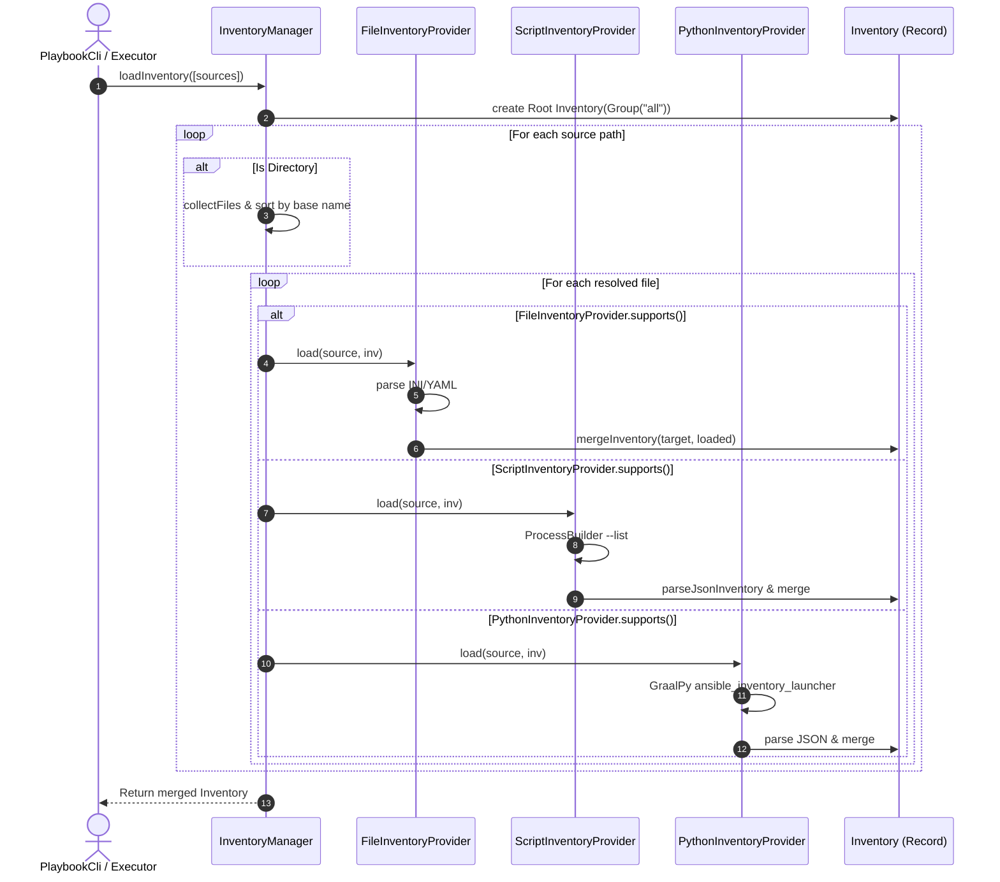
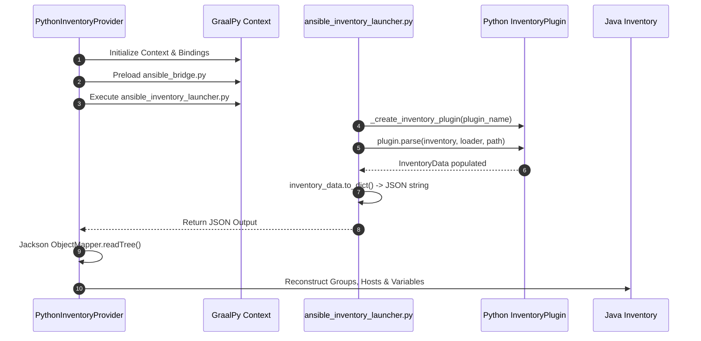

# インベントリシステムの実装詳細 (Inventory System Implementation)

本ドキュメントでは、Ansible 互換のインベントリ管理システムの内部設計および実装方法について詳述します。

## 1. データ構造

インベントリ情報を表現するために、以下の Java Record を使用します。

### 1.1 Host
個々のターゲットノードを表します。
- `name`: ホスト名または IP アドレス。
- `variables`: ターゲットノード固有の変数（`Map<String, Object>`）。

### 1.2 Group
ターゲットノードの集合を表します。
- `name`: グループ名。
- `hosts`: グループに属するターゲットノードのリスト（`List<Host>`）。
- `children`: 子グループのリスト（`List<Group>`）。
- `variables`: グループ変数（`Map<String, Object>`）。

### 1.3 Inventory
インベントリ全体を管理します。
- `all`: 全てのターゲットノードとグループを内包するルートグループ（`Group`）。

### 1.4 構造と可変性
すべてのデータモデル（Host, Group, Inventory）は Java **Record** として実装されていますが、`add_host` や `group_by` モジュールによる実行時の動的なインベントリ更新をサポートするため、内部で保持するリスト（hosts, children）やマップ（variables）は可変（Mutable）なコレクション（`ArrayList`, `HashMap`）として保持されます。

## 2. 解析ロジック (INI 形式)

`IniInventoryParser` は以下の規則に従って INI ファイルを解析します。

1. **セクションなし**: ファイルの先頭にあるセクションに属さないホストは `all` グループに直接追加されます。
2. **グループセクション (`[group_name]`)**: その後に続くホストは、指定されたグループに属します。
3. **子グループセクション (`[group_name:children]`)**: 指定されたグループの子として登録されるグループ名を記述します。
4. **変数セクション (`[group_name:vars]`)**: グループ全体に適用される変数を `key=value` 形式で記述します。

## 3. 解析ロジック (YAML 形式)

`YamlInventoryParser` は以下の規則に従って YAML ファイルを解析します。

1. **ルート要素**: 原則として `all` グループをルートとします。
2. **ホスト定義 (`hosts`)**: 各グループ配下の `hosts` キーにホスト名を記述します。ホスト個別の変数はその値として定義します。
3. **子グループ定義 (`children`)**: 各グループ配下の `children` キーに子グループを定義します。
4. **変数定義 (`vars`)**: 各グループ配下の `vars` キーにグループ変数を定義します。

## 4. 変数の解決順序

インベントリにおける変数の解決順序は、[変数とテンプレートの実装詳細](Variables-Templating.md#2-変数優先順位-variable-precedence) に基づき、以下の優先順位で解決されます。

1. `all` グループ変数
2. 親グループ変数
3. 子グループ変数
4. ホスト固有の変数

### 4.1 複数グループに属する場合の挙動
ターゲットノードが複数のグループに属している場合、それぞれのグループパスを辿って変数を収集し、マージします。この際、ターゲットノード固有の変数が最終的にすべてのグループ変数を上書きします。

### 4.2 優先順位 3-10 の厳密な実装
[変数とテンプレートの実装詳細](Variables-Templating.md#2-変数優先順位-variable-precedence) に基づく優先順位 3 から 10 を正確に実現するため、`Inventory.java` においてグループ変数（`getGroupVariablesForHost`）とホスト変数（`getHostVariables`）の取得メソッドを分離しています。これにより、`VariableManager` は以下の順序で変数をマージし、インベントリホスト変数（優先度 8）がプレイブックグループ変数（優先度 7）を正しく上書きすることを保証します。

1. 優先度 3-7: `getGroupVariablesForHost` で取得されたインベントリ/プレイブックのグループ変数を順次マージ。
2. 優先度 8-10: `getHostVariables` で取得されたインベントリホスト変数、および `host_vars/*` をマージ。

## 5. 外部インベントリおよびプロバイダーの実装詳細 (External Inventory Integration)

インベントリのソース（静的ファイル、スクリプト、プラグイン）を抽象化するため、`InventoryProvider` インターフェースおよび具象クラスを実装しています。

```java
public interface InventoryProvider {
    /**
     * 指定されたソースを処理可能かどうかを判定します。
     */
    boolean supports(String source);

    /**
     * ソースからインベントリを読み込み、Inventory オブジェクトを構築または更新します。
     * @param source ソースのパスまたは識別子
     * @param inventory 更新対象のインベントリ
     */
    void load(String source, Inventory inventory);
}
```

### 5.1 静的ファイルプロバイダー (`FileInventoryProvider`)
- **判定ロジック (`supports`)**:
  - ファイルが存在しかつファイルであるかを検証。
  - OS が Windows の場合は `.ini`, `.yml`, `.yaml`, `.txt` 拡張子で判定。
  - POSIX OS の場合は `!file.canExecute()` で非実行ファイルであることを確認。
- **再帰的ツリーマージ処理 (`mergeInventory` / `mergeGroup`)**:
  - `load` 呼び出し時、拡張子に応じて `YamlInventoryParser` または `IniInventoryParser` を生成してパース。
  - 読み込まれた `Inventory` ツリーを既存の `target` インベントリへ再帰的にマージ（`mergeGroup`）。
  - 変数マップの結合（`target.variables().putAll(source.variables())`）、ホストの重複チェックと変数結合、および子グループ構造の再帰結合を実施。

### 5.2 スクリプト方式プロバイダー (`ScriptInventoryProvider`)
実行可能なプログラムから JSON 形式でインベントリ情報を取得します。

- **判定ロジック (`supports`)**:
  - POSIX OS: `file.canExecute()` が `true` のファイルをスクリプトとして判定。
  - Windows: `.py`, `.bat`, `.ps1`, `.exe` 拡張子を持つファイルを判定。
- **実行メカニズム (`load`)**:
  - `ProcessBuilder` を用いて、指定されたスクリプトを `--list` 引数付きで実行。Windows 上の `.py` ファイルに対してはコマンドの先頭に `python` を追加。
  - 標準エラー出力は `Inherit` 形式で親プロセスへ継承し、標準出力をキャプチャして Jackson (`ObjectMapper`) で JSON を解析。
- **データマッピング (`parseJsonInventory`)**:
  - JSON の `_meta.hostvars` から各ホストの変数を取得。
  - 各グループ配下の `vars` マップ、`hosts` 配列（`all` や既存グループへの自動割り当て）、および `children` 配列を再帰的に解析して内部 `Inventory` オブジェクトへ挿入・マージ。

### 5.3 プラグイン方式プロバイダー (`PythonInventoryProvider`)
YAML 設定ファイルに基づき、GraalPy 上で Python 製 Ansible Inventory Plugin を動的にロード・実行します。

- **判定ロジック (`supports`)**:
  - ファイル拡張子が `.yml` または `.yaml` であるかを検証。
  - `YamlUtil.createYaml()` を用いてファイルをロードし、最上位に `plugin` キー（例: `amazon.aws.aws_ec2`）が定義されている場合に対象ファイルとして自動判定。
- **GraalPy 統合とブリッジ**:
  - `Context` API を介して GraalPy 実行環境を構築（`python.IsolateNativeModules` は `false`）。
  - Java 側の `PythonOSMock` および `PythonAnsibleModuleMock.Factory` を Python ビンディングに注入し、`ansible_bridge.py` を事前ロード。
- **プラグイン実行と変換 (`load`)**:
  - `ansible_inventory_launcher.py` を呼び出し、`ansible_bridge._createinventory_plugin(plugin_name)` 経由で本物の Python プラグインを動的に解決・インスタンス化し `plugin.parse(...)` を呼び出し。
  - `InventoryData` から `to_dict()` で JSON シリアライズされたデータを Jackson でパースし、Java の `Inventory` レコードへパージ・マージ。

## 6. インベントリ・マネージャーとディレクトリ走査 (`InventoryManager`)

`InventoryManager` は複数の `InventoryProvider` を保持し、1つ以上のインベントリソース（ファイルまたはディレクトリ）を統括・マージします。

### 6.1 ディレクトリ走査とソートアルゴリズム
1. 指定されたソースがディレクトリの場合、`collectFiles` メソッドで再帰的にファイルを収集。
2. 収集されたファイルリストを `Comparator.comparing(f -> f.getName().toLowerCase())` で大文字小文字を無視したベース名順にソート。
3. ソートされた順序で `loadSingleSource(..., isFromDirectory=true)` を順次実行。

### 6.2 自動除外ルール
`collectFiles` での走査時、以下を自動フィルタリング:
- `name.startsWith(".")`: ドット開始の隠しファイル・ディレクトリ。
- `IGNORED_DIRECTORIES`: `"vars"`, `"group_vars"`, `"host_vars"`。
- `IGNORED_EXTENSIONS`: `"~"`, `".bak"`, `".old"`, `".orig"`, `".retry"`, `".rpmnew"`, `".rpmsave"`, `".tmp"`。

### 6.3 エラーハンドリングのハンドラー分け
- `isFromDirectory == false`（明示的ファイル指定）: 対応する `InventoryProvider` が見つからない場合 `RuntimeException` をスロー。
- `isFromDirectory == true`（ディレクトリ自動走査）: 未対応ファイルは警告ログ (`LOGGER.warning`) のみ出力しスキップ。

## 7. group_vars / host_vars 変数ディレクトリのロード実装 (`VariableManager.loadDirectoryVars`)

`VariableManager` は、インベントリディレクトリ (`inventoryDir`) およびプレイブックディレクトリ (`baseDir`) 直下の `group_vars` / `host_vars` から変数を読み込みます。

### 7.1 ディレクトリ変数読込アルゴリズム
`VariableManager.loadDirectoryVars(Path dir, String subDir, String name)`:
1. キャッシュキー `dir:subDir:name` で `directoryVarsCache` を確認。存在すれば即返却。
2. 対象ディレクトリ `dir.resolve(subDir)`（例: `<invDir>/group_vars`）が存在するか確認。
3. **単一ファイルの探索**:
   - `<name>.yml`, `<name>.yaml`, `<name>.json` を `loadVarsFileFromPath` でロードし、順次マージ。
4. **サブディレクトリの探索**:
   - ディレクトリ `<name>/`（例: `group_vars/webservers/`）が存在する場合、`Files.list` で直下のファイルを列挙。
   - `.yml`, `.yaml`, `.json` 拡張子を持つファイルをソートし、順次ロードしてマージ。
5. 読込結果を `directoryVarsCache` に保存してマージマップを返却。

## 8. ホストパターンのマッチングと範囲パターン展開 (Bracket-Aware Splitting & Range Pattern Expansion)

### 8.1 Bracket-Aware Splitting（ブラケットを考慮した分割）
入力パターン文字列を 1 文字ずつ走査し、ブラケットのネストレベル（`[` で `+1`、`]` で `-1`）を追跡。ネストレベルが `0` の位置でのみカンマ（`,`）またはコロン（`:`）でトークンに分割。

### 8.2 範囲パターンの展開（Range Pattern Expansion）
`HostPatternParser.expandPattern`:
- **数値範囲**: 正規表現 `^(\d+)([:-])(\d+)$` を用いて解析。開始文字列の先頭が `"0"` かつ長さが 2 以上の場合は桁数揃え（0 埋め）。
- **アルファベット範囲**: 正規表現 `^([a-zA-Z])([:-])([a-zA-Z])$` を用いて解析。
- **方向性**: `start > end` の場合は降順（`-1` ステップ）展開。
- **直積展開（Cartesian Product）**: 1つの文字列内に複数ブラケットが含まれる場合、最初のブラケット展開後に各要素へ再帰適用し直積を算出。

## 9. 処理フロー図 (Mermaid Diagrams)

### 9.1 インベントリ構築とマージ処理フロー



### 9.2 Python Inventory Plugin 実行シーケンス


