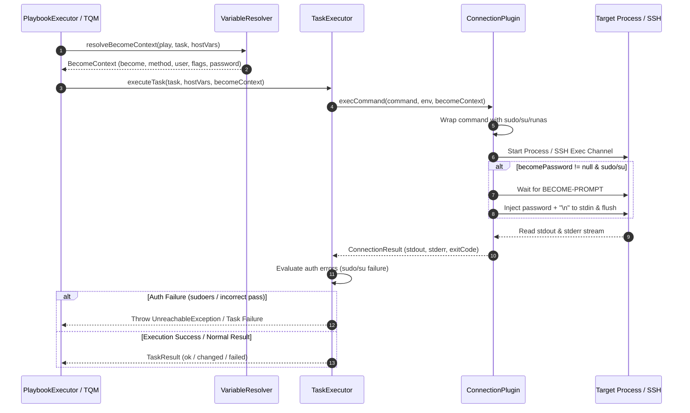

# 権限昇格 (Privilege Escalation / become)

`graal-ansible` における権限昇格（`become`）の仕様および実装詳細を定義します。本家 Ansible の `become` 機能を Java 実行エンジン、変数解決器（`VariableResolver`）、および各接続プラグイン（`LocalConnection`, `SshConnection`, `DockerConnection`, `WinRMConnection`）でどのように処理・統合するかを詳述します。

## 1. 概要

ターゲットノード上で、ログインユーザー（接続ユーザー）とは別の特権ユーザー（通常は `root` または管理者アカウント）としてタスクを実行するための仕組みです。接続プラグインを通じて、`sudo`, `su`, `runas` などのオペレーティングシステム固有のコマンドやメカニズムを用いて透過的に実現します。

### 1.1 権限昇格の全体データフロー (Sequence Flow)

以下に、Playbook 実行エンジンからタスク解決、接続プラグイン経由での特権コマンド構築、およびパスワード注入までのシーケンスフローを示します。



## 2. サポートするキーワードと変数優先順位

プレイ（Play）およびタスク（Task）レベルで、以下のキーおよび対応するインベントリ/CLI 変数をサポートします。

| キーワード | 対応する変数名 | 型 | デフォルト値 | 説明 |
| :--- | :--- | :--- | :--- | :--- |
| `become` | `ansible_become` | `Boolean` | `false` | 権限昇格を有効にするかどうか。 |
| `become_method` | `ansible_become_method` | `String` | `"sudo"` | 使用する権限昇格ツール (`sudo`, `su`, `runas`, `doas` 等)。 |
| `become_user` | `ansible_become_user` | `String` | `"root"` | 昇格後の目的ユーザー名。 |
| `become_flags` | `ansible_become_flags` | `String` | `""` | 昇格用コマンドに渡す追加のフラグ（例: `-H -n`）。 |
| N/A | `ansible_become_password` | `String` | `null` | 権限昇格実行に必要なパスワード。 |

### 2.1 パスワード変数の解決優先順位
権限昇格用パスワード（`becomePassword`）の参照時、`VariableResolver` は以下の順序で変数を探索し、最初に存在する（非 null の）値を採用します：

1. `ansible_become_password`（標準キー）
2. `ansible_become_pass`（後方互換用エイリアス）
3. `ansible_sudo_pass`（レガシー互換用エイリアス）

## 3. CLI インテグレーションとプロンプト応答

コマンドライン引数（CLI）で指定された権限昇格設定は、Playbook 内の定義のオーバーライド、あるいはデフォルト動作の変更として機能します。

### 3.1 CLI オプションのマップ
`PlaybookCli` において、以下の権限昇格用コマンドライン引数がサポートされています。受け取った値は「CLI 変数（優先度 Level 1）」として `VariableManager` に登録されます。

- `-b` / `--become` -> `ansible_become = true`
- `--become-method <method>` -> `ansible_become_method = <method>`
- `--become-user <user>` -> `ansible_become_user = <user>`
- `--become-flags <flags>` -> `ansible_become_flags = <flags>`
- `-K` / `--ask-become-pass` -> インタラクティブ・プロンプトからパスワードを取得

### 3.2 パスワードのインタラクティブ取得 (`PromptProvider`)
`-K` または `--ask-become-pass` オプションが指定された場合、実行開始時に抽象化インターフェース `PromptProvider`（標準実装: `ConsolePromptProvider`）を介して安全に入力を求めます。

- `ConsolePromptProvider` は `System.console().readPassword()` を使用して、ターミナル上に文字を表示させずに暗号化非表示でパスワードを取得します。
- 取得されたパスワードは `ansible_become_password` 変数として `VariableManager`（Level 1 または Level 22）に登録され、以降のすべての昇格処理で共有されます。

### 3.3 非対話型（Headless）環境におけるエラー処理仕様
CI/CD パイプラインやバックグラウンドプロセスなど、コンソール（TTY）が存在しない非対話型環境（`System.console() == null`）で `-K` / `--ask-become-pass` が指定された場合、`ConsolePromptProvider` は入力を促すことができずハングするのを防止するため、即座に `AnsibleException` をスローします。

- **エラーメッセージ**: `Console prompt is not available in headless environment. Please provide password via extra-vars (-e) or vault password file.`

## 4. BecomeContext データモデルと解決ロジック

### 4.1 データモデル (`BecomeContext`)

権限昇格の実行情報をコンテキストとして不変（Immutable）に保持するため、`org.example.ansible.connection.BecomeContext` Java **Record** を使用します。

```java
public record BecomeContext(
        boolean become,
        String becomeMethod,
        String becomeUser,
        String becomeFlags,
        String becomePassword
) {
    public static BecomeContext empty() {
        return new BecomeContext(false, "sudo", "root", "", null);
    }
}
```

### 4.2 解決シーケンスと評価ロジック (`VariableResolver.resolveBecomeContext`)

`VariableResolver.resolveBecomeContext(Play play, Task task, Map<String, Object> variables)` は、タスク実行の直前に以下の優先順位に従ってプロパティごとの値を解決・マージします：

1. **`become` の解決**:
   - `Task.become()` が存在する場合は最優先で採用。
   - 存在しない場合は `Play.become()` を参照。
   - どちらも未指定（null）の場合は `variables.get("ansible_become")` を参照。
   - 取得されたオブジェクトを `Truthiness.isTrue()` により真偽値に評価します。
2. **`becomeMethod` の解決**:
   - `Task.becomeMethod()` -> `Play.becomeMethod()` -> `variables.get("ansible_become_method")` -> デフォルト値 `"sudo"`。
3. **`becomeUser` の解決**:
   - `Task.becomeUser()` -> `Play.becomeUser()` -> `variables.get("ansible_become_user")` -> デフォルト値 `"root"`。
4. **`becomeFlags` の解決**:
   - `Task.becomeFlags()` -> `Play.becomeFlags()` -> `variables.get("ansible_become_flags")` -> デフォルト値 `""`。
5. **`becomePassword` の解決**:
   - 2.1 節で定義したパスワード優先順位に従って変数を検索。

#### 特殊ルール (CLI `--become` オーバーライド)
Ansible の標準仕様に従い、CLI で `-b` / `--become` が明示的に指定された場合、Playbook 側で `become` が定義されていないすべてのタスクで昇格が有効となります。ただし、特定タスクで明示的に `become: no` (`false`) が指定されている場合は、CLI の指定に関わらずそのタスクでの昇格は無効化されます。

## 5. 権限昇格コマンドの構築と実行メカニズム

接続プラグインが `execCommand` を呼び出す際、`BecomeContext.become()` が `true` であればターゲット OS および `becomeMethod` に応じたコマンドラッパーの構築とパスワード注入を行います。

### 5.1 `sudo` モード (`become_method=sudo`)

Unix / Linux 環境における標準的な昇格方式です。

- **コマンド構築構文**:
  ```bash
  sudo -H -S -n -p BECOME-PROMPT [-u <become_user>] [<become_flags>] /bin/sh -c '<command>'
  ```
  - `-H`: 目的ユーザーの HOME 環境変数を設定。
  - `-S`: 標準入力（stdin）からパスワードを読み込む。
  - `-n`: 非インタラクティブモード（パスワード未設定時のハング防止）。
  - `-p BECOME-PROMPT`: パスワードプロンプト識別用の固定マーカー文字列。
  - `-u <become_user>`: `become_user` が指定されている場合（かつ非 root 時）に追加。
- **標準入力ストリームへのパスワード注入**:
  - パスワードが存在する場合（`becomePassword != null`）、子プロセスの標準入力ストリーム（`process.getOutputStream()` または `channel.getInvertedIn()`）へ、`becomePassword + "\n"` を UTF-8 で書込み、`flush()` を即座に実行します。

### 5.2 `su` モード (`become_method=su`)

`sudo` が利用できない環境や、`su` コマンドによるユーザー切替を行う方式です。

- **コマンド構築構文**:
  ```bash
  su [<become_user>] -c '<command>'
  ```
- **パスワード注入**:
  - `sudo` と同様に、プロンプト生成待機後に標準入力へ `becomePassword + "\n"` を書き込んで送信します。

### 5.3 `runas` モード (`become_method=runas`)

Windows 環境（WinRM）における特権実行方式です。

- WinRM 接続（`WinRMConnection`）において、既存セッション上で `WinRM4J` クライアントを生成する際、解決された `becomeUser` および `becomePassword` を用いて WinRM セッション自体の認証資格情報を動的に上書き・再作成します。

### 5.4 ネイティブ Docker ユーザー切替 (`docker exec -u`)

Docker コンテナ内での実行（`DockerConnection`）において、`become_method=runas` または `become_user` が指定された場合、`docker exec` CLI の `-u` オプションに `becomeUser`（未指定時は `root`）を直接指定することで、Docker レベルで特権ユーザー切り替えを行います。

### 5.5 プロンプト検知メカニズム (Prompt Detection)

接続プラグインでは、プロセス起動後に標準出力 / 標準エラー出力ストリームを監視し、プロンプト文字列を検出してパスワードの注入タイミングを制御します。

- **プロンプトマーカー一致**: `sudo -p BECOME-PROMPT` により、出力ストリーム中に `BECOME-PROMPT` 文字列が含まれるかをリアルタイム判定します。
- **レガシープロンプト正規表現**: `su` や標準プロンプトの場合、以下の正規表現パターンで動的検出を行います:
  - `(?i)(?:password|パスワード)\s*:`
- **タイムアウト保護**: プロンプト待ちで 10 秒以上応答がない場合、プロセスのハング防止のためパスワード注入処理を中断し、タイムアウト例外を発生させます。

## 6. コネクションプラグイン別の統合仕様

各接続プラグインでの `BecomeContext` 統合と処理内容は以下の通りです。

| プラグイン名 | 昇格コマンドラッピング | パスワード注入方式 | 特徴・備考 |
| :--- | :--- | :--- | :--- |
| **`LocalConnection`** | `ProcessBuilder` コマンドリスト書き換え (`sudo -S -p BECOME-PROMPT ...`) | `process.getOutputStream().write()` | `OSHandler.supportsSudo()` が真の場合に発動。非同期ストリーム読み込みによるデッドロック防止。 |
| **`SshConnection`** | MINA SSHD `ChannelExec` コマンド文字列書き換え | `channel.getInvertedIn().write()` | リモートチャネルの stdin に直接パスワード注入。踏み台サーバー経由の多段トンネル上でも透過動作。 |
| **`DockerConnection`** | `docker exec [-u <user>] ...` または `sudo` ラッピング | `process.getOutputStream().write()` | コンテナの指定ユーザー（`root` 等）によるプロセス直接実行またはコンテナ内 `sudo` / `su` 実行。 |
| **`WinRMConnection`** | PowerShell スクリプトブロックラッパー | `WinRM4J` クライアント認証情報の再生成 | Windows ターゲットに対する `runas` 認証設定の上書き実行。 |

## 7. エラーハンドリングと認証失敗検知

権限昇格実行時における失敗シナリオおよびエラー検知ルールは以下の通り定義されます。

### 7.1 エラーパターンと例外マッピングマトリクス

| エラーパターン（stderr / stdout 判定） | 原因・条件 | スローされる例外 | タスク実行結果 |
| :--- | :--- | :--- | :--- |
| `sudo: a password is required` | `sudo` パスワード未指定 | `UnreachableException` | Host Unreachable |
| `sudo: 1 incorrect password attempt` / `Password:` 再要求 | `sudo` パスワード間違い | `UnreachableException` | Host Unreachable |
| `su: Authentication failure` / `su: Incorrect password` | `su` 認証失敗 | `UnreachableException` | Host Unreachable |
| `is not in the sudoers file` | `sudoers` 権限不備 | `UnreachableException` | Host Unreachable |
| `sudo: option requires an argument` | `become_flags` 設定不正 | `ModuleExecutionException` | Task Failed |
| 非ゼロ exitCode (コマンド本体のエラー) | 昇格後の実行エラー | なし (`ConnectionResult`) | Task Failed / Evaluated |

### 7.2 例外および実行結果へのマッピングルール
- **`UnreachableException` へのマッピング**:
  - 権限昇格パスワードの入力ミスや `sudoers` 権限不備によりタスクが進行不能となった場合、該当ホストを即時到達不能ステータスに移行させるため `UnreachableException` をスローします。
- **`ConnectionResult` へのマッピング**:
  - 権限昇格後のコマンド実行自体が非ゼロで失敗した場合は、通常の `ConnectionResult(stdout, stderr, exitCode)` として集計され、タスクの `failed_when` や `ignore_errors` ロジックへと引き渡されます。

## 8. セキュリティおよび Native Image 考慮事項

### 8.1 メモリ上のパスワード保護とバッファ消去
- **`char[]` バッファの採用**: パスワードを読み込むプロンプト（`ConsolePromptProvider`）では、Java 不変オブジェクトである `String` ではなく `char[]` バッファを内部保持します。
- **即時ゼロ埋め消去 (Memory Zeroing)**: 標準入力ストリームへの書き込みが完了した直後に、`Arrays.fill(passwordBuffer, '\0')` を呼び出し、ヒープ上にパスワード平文データが残存しないようメモリクリア処理を実行します。

### 8.2 ログのマスキング処理
- ログ出力（デバッグログおよび標準出力）において、パスワード文字列や `-p BECOME-PROMPT` 注入部分のパスワード平文がそのまま表示されないよう自動マスキング処理（`***` 置換）を適用します。

### 8.3 GraalVM Native Image 対応
- `sudo` や `su` 等のローカルプロセスコマンド呼び出しで使用される `ProcessBuilder` の実行クラスおよび OS コマンドパスについて、`resource-config.json` 等で正しくネイティブアクセスが許可されていることを保証します。
