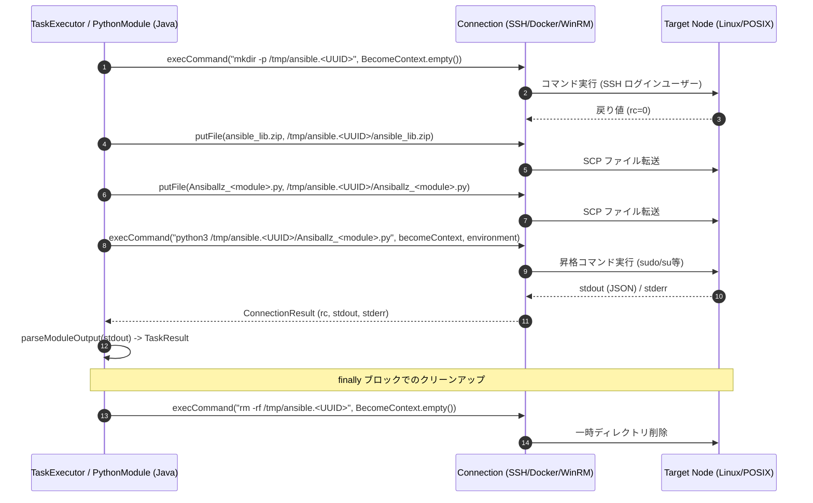

# リモートノードでのモジュール実行仕様 (Ansiballz)

本ドキュメントでは、`graal-ansible` がターゲットノード（リモートノード）に対して Ansible モジュールを実行する際のアーキテクチャ、依存関係パッケージング、Ansiballz ラッパースクリプト生成、および実行ライフサイクルについて詳述します。

## 1. 概要

`graal-ansible` では、ターゲットノード上でモジュールを実行する際、本家 Ansible と同様にモジュールファイルと必要な Python 依存ライブラリをターゲットノードに転送して実行する「モジュール転送型（Ansiballz）」モデルを採用しています。

管理ノード側の GraalPy に依存せず、ターゲット環境の Python インタプリタとシステムリソースを活用することで、高度なネイティブ依存を持つモジュールでも完全な互換性を維持して実行することを可能にしています。

---

## 2. モジュール探索・解決メカニズム (`findModuleFile`)

ターゲットノードでの実行を開始する前に、管理ノード上のローカルファイルシステムから実行対象の Python モジュール本体 (`.py`) を探索・特定します。

### 2.1 探索順序とルール
1. **名前空間の正規化**:
   - `ansible.builtin.<module>` や `ansible.legacy.<module>` のプレフィックスを除去し、ベースモジュール名を取得します。
2. **コレクション（`ansible_collections`）の探索**:
   - モジュール名にドットが含まれる場合（例: `community.general.opkg`）、指定されたコレクション探索パス（`TaskExecutor.getCurrentCollectionPaths()` または `PythonEnv.getCollectionPaths()`）から以下の相対パスを検索します。
   - `ansible_collections/<namespace>/<collection>/plugins/modules/<module>.py`
3. **Ansible コア組み込みモジュールの探索**:
   - `site-packages`（`PythonEnv.getSitePackagesFromEnv()`）配下の `ansible/modules/<baseName>.py` を検索します。

| パラメータ / 戻り値 | 型 | 説明 |
| :--- | :--- | :--- |
| `moduleName` | `String` | 実行対象モジュール名（例: `ping`, `ansible.builtin.copy`）。 |
| 戻り値 | `Optional<File>` | 見つかったモジュールファイルの `File` オブジェクト（未発見時は `Optional.empty()`）。 |

未発見時は `TaskResult.failure("Module source not found: " + moduleName)` を返却します。

---

## 3. 依存関係 ZIP (`ansible_lib.zip`) の動的生成とキャッシュ (`getOrCreateDependencyZip`)

Ansible モジュールの実行には `ansible.module_utils` などのコアライブラリが必要です。ターゲットノードに Ansible 本体がインストールされていない環境でも動作させるため、必要なコアモジュール群を1つの ZIP ファイル (`ansible_lib.zip`) に集約して転送します。

### 3.1 ZIP パッケージ構造
`PythonModule.getOrCreateDependencyZip()` メソッドは、管理ノードの `site-packages` 内の `ansible` ディレクトリから以下のコア構成要素を抽出し、メモリ/一時ディレクトリ内に `ansible_lib.zip` を構築します。

| ZIP 内パス | 抽出元 | 役割 |
| :--- | :--- | :--- |
| `ansible/__init__.py` | `ansible/__init__.py` | パッケージ初期化。 |
| `ansible/release.py` | `ansible/release.py` | Ansible バージョン情報定義。 |
| `ansible/modules/__init__.py` | `ansible/modules/__init__.py` | モジュールパッケージ初期化。 |
| `ansible/module_utils/**` | `ansible/module_utils/` (再帰的) | モジュールユーティリティ群 (`basic.py`, `urls.py` 等)。 |
| `ansible/_vendor/**` | `ansible/_vendor/` (再帰的) | 内蔵サードパーティライブラリ。 |
| `ansible/_internal/**` | `ansible/_internal/` (再帰的) | 内部ヘルパーユーティリティ。 |
| `ansible/compat/**` | `ansible/compat/` (再帰的) | Python 2/3 互換性レイヤー。 |

### 3.2 キャッシュ戦略とスレッドセーフ
- **`dependencyZipCache`**: `ConcurrentHashMap<String, Path>` を使用し、`site-packages` のパス組み合わせをキー（`String.join(":", sitePackages)`）として生成済み ZIP パスをキャッシュします。
- **排他制御**: `getOrCreateDependencyZip()` は `synchronized` メソッドとして実装され、マルチスレッド環境での同一 ZIP の重複構築を防ぎます。
- **一時ファイル設定**: 作成された ZIP ファイルは `deleteOnExit()` を設定し、JVM 終了時に自動削除されます。

---

## 4. Ansiballz ラッパースクリプトの生成とコード注入 (`wrapModule`)

転送対象のモジュールコードと実行引数（JSON）は、特製のラッパースクリプト（`Ansiballz_<moduleName>.py`）内にカプセル化されます。

### 4.1 引数バインディングマトリクス

| パラメータ | 型 | 説明 |
| :--- | :--- | :--- |
| `moduleFile` | `File` | 実行対象モジュールの Python ソースファイル。 |
| `args` | `Map<String, Object>` | モジュール実行引数（JSON エンコード後、Base64 化）。 |
| `zipFileName` | `String` | ターゲットノード上での依存関係 ZIP 名（`ansible_lib.zip`）。 |

### 4.2 ラッパースクリプトの構成要素と Base64 エンコーディング

```
+-------------------------------------------------------------+
| 1. 標準ライブラリインポート                                    |
|    (json, sys, os, base64, __main__, types)                 |
+-------------------------------------------------------------+
| 2. JSON dumps パッチ (`patched_dumps`)                         |
|    - bytes/bytearray の UTF-8/Latin-1 自動デコード           |
|    - GraalVM WrappedValue / Exception のクリーニング          |
+-------------------------------------------------------------+
| 3. sys.path 調整                                            |
|    - script_dir に配備された ansible_lib.zip を sys.path 先頭に挿入|
+-------------------------------------------------------------+
| 4. Base64 符号化引数の復元                                    |
|    - complex_args = json.loads(base64.b64decode(...))      |
+-------------------------------------------------------------+
| 5. ansible.module_utils.basic へのモンキーパッチ             |
|    - _load_params メソッドのオーバーライド                     |
|    - _ANSIBLE_PROFILE = 'modern'                            |
|    - _PARSED_MODULE_ARGS = complex_args                     |
+-------------------------------------------------------------+
| 6. モジュールコードの復元と exec 実行                          |
|    - module_code = base64.b64decode(...).decode('utf-8')    |
|    - exec(compile(module_code, ...), {'__name__': '__main__'})|
+-------------------------------------------------------------+
```

### 4.3 安全性と互換性のための工夫
- **Base64 エンコーディング**: モジュールコードおよび JSON 引数を Base64 符号化して埋め込むことで、シェル転送時や特殊文字（改行、クォート等）のエスケープ事故を完全に防止します。
- **`patched_dumps`**: モジュールが返す JSON レスポンス内にバイナリデータや非シリアライズ可能オブジェクトが含まれていた場合でも、安全に文字列へ変換して正常な JSON を生成させます。
  - `bytes` / `bytearray`: まず UTF-8 でデコードを試み、失敗した場合は Latin-1 でデコード。
  - `WrappedValue`: GraalPy の `value` / `_value` 属性を抽出し再帰的にクリーン化。
  - `Exception`: `{'failed': True, 'msg': str(o)}` 辞書へ安全に変換。

---

## 5. リモート実行ライフサイクルと動作フロー

`PythonModule.executeRemotely()` によるリモート実行の全体シーケンスを以下に示します。

### 5.1 Mermaid シーケンスフロー (Sequence Flow)



### 5.2 各ステップの詳細と権限昇格分離 (Privilege Escalation Isolation)
1. **一時ディレクトリの作成 (`mkdir -p`)**:
   - `/tmp/ansible.<UUID>` というユニークな一時ディレクトリを作成します。
   - **権限昇格の分離**: ディレクトリ作成時には `BecomeContext.empty()` を使用します。これにより、ファイル転送を実行する SSH ログインユーザー自身が所有者となり、後続の SCP 転送時のパーミッションエラーを防ぎます。
2. **ファイルの転送 (`putFile`)**:
   - `ansible_lib.zip` および動的生成した `Ansiballz_<moduleName>.py` を転送します。
3. **リモート実行 (`python3`)**:
   - `connection.execCommand("python3 " + remoteModulePath, becomeContext, TaskExecutor.getCurrentEnvironment())` を呼び出します。
   - 実際のタスクで指定された `becomeContext`（例: sudo / root ユーザー昇格）および `environment` 変数がここで適用されます。
4. **出力解析とクリーンアップ**:
   - 標準出力から JSON レスポンスを抽出し、`TaskResult` へ変換します。
   - 成功/失敗にかかわらず、`finally` ブロックで `connection.execCommand("rm -rf " + remoteTmpDir, BecomeContext.empty(), null)` を呼び出し、一時ディレクトリを確実に削除します。

---

## 6. 出力解析とエラーハンドリング (`parseModuleOutput`)

ターゲットノード上の Python プロセスが出力する標準出力には、モジュールの JSON 以外にデバッグログや警告メッセージ、インプットプロンプトの残骸などが混入する場合があります。

### 6.1 JSON 抽出アルゴリズム (`parseModuleOutput`)
1. 標準出力を改行（`\r?\n`）で分割し、末尾の行から順に `{` と `}` で囲まれた領域を探します。
2. 有効な JSON オブジェクト部分（最初に一致した `{` から `}` まで）のみを抽出してデコードします。
3. 該当する行が見つからない場合は、文字列全体の最初の `{` から最後の `}` を抽出します。

### 6.2 エラーマッピングマトリクス

| 発生条件 | エラーメッセージ / マッピング | レスポンス型 |
| :--- | :--- | :--- |
| モジュールファイル未発見 | `Module source not found: <moduleName>` | `TaskResult.failure` |
| 依存 ZIP 作成失敗 | `Failed to create dependency ZIP: <message>` | `TaskResult.failure` |
| リモート一時ディレクトリ作成失敗 (`rc != 0`) | `Failed to create remote temp dir: <stderr>` | `TaskResult.failure` |
| SCP ファイル転送エラー (`IOException`) | `Failed to prepare module: <message>` | `TaskResult.failure` |
| リモート `python3` 不在 / 出力空 (`rc != 0`) | `Module produced no output (exit code X): <stderr>` | `TaskResult.failure` |
| モジュール処理失敗 (`failed: true`) | `resultMap.get("msg")` | `TaskResult(success=false, changed=false, ...)` |

---

## 7. 接続プラグイン連携 (`Connection` / `SshConnection` / `DockerConnection` / `WinRMConnection`)

リモートモジュール実行は、`Connection` インターフェース抽象化を通じて動作します。

- **`SshConnection`**: Apache MINA SSHD をベースとし、`ChannelExec` によるリモートコマンド実行と `ScpClient` によるファイル転送を行います。
- **`DockerConnection`**: Docker CLI (`docker exec`, `docker cp`) 経由でコンテナ内でのリモート実行およびファイル転送に対応します。
- **`WinRMConnection`**: WinRM4J を使用して Windows ターゲットに対する PowerShell / Python 実行および Base64 チャンクファイル転送をサポートします。

---

## 8. 利点と制約事項

### 8.1 利点
- **高互換性**: ターゲットノードの Python インタプリタ、カーネル、システムユーティリティと直接対話するため、Ansible 本家と同等の動作が保証されます。
- **環境分離**: 各タスクは独立したテンポラリディレクトリとプロセスで実行され、タスク間の副作用が防止されます。

### 8.2 制約事項
- **ターゲット要件**: ターゲットノード上に Python 3 (`python3`) がインストールされている必要があります。
- **転送オーバーヘッド**: SSH コネクション経由で ZIP ファイルおよびスクリプトを転送するため、ローカル実行に比べて通信レイテンシが発生します。

---

## 9. 関連ドキュメント
- [接続プラグイン実装](Connection-Plugins.md)
- [Ansible モジュールの初期化と設定](Ansible-Module-Initialization.md)
- [権限昇格 (become)](Privilege-Escalation.md)
- [OS非依存レイヤー](OS-Abstraction.md)
