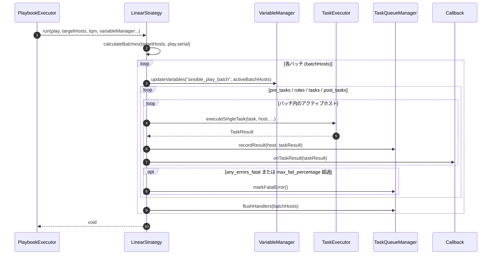
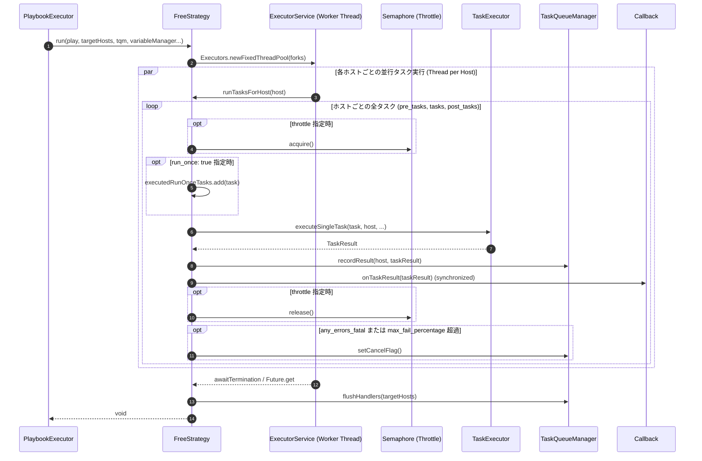

# ストラテジ・プラグインの実装仕様 (Strategy Plugins Implementation)

本ドキュメントでは、`graal-ansible` におけるタスク実行戦略（ストラテジ）の設計方針、コンポーネント構成、スレッド同期メカニズム、バッチ算定アルゴリズム、および実装詳細について詳述します。

## 1. 概要

ストラテジ・プラグインは、Playbook 内の各 Play において、複数のターゲットホストに対してどのようにタスクを配信・順序制御して実行するかを担うコンポーネントです。Ansible 本家と同様に、`linear`（順次同期実行）および `free`（ホスト独立並列実行）などの戦略を切り替え可能にします。`graal-ansible` では、これらの主要戦略が完全に実装され、実行エンジン（`TaskQueueManager`）に統合されています。

## 2. インターフェース定義とパラメータ仕様

Java で実装されるすべてのストラテジ・プラグインは、以下の `Strategy` インターフェースを実装します。

```java
public interface Strategy {
    /**
     * 指定された Play を実行します。
     *
     * @param play             実行対象の Play オブジェクト
     * @param targetHosts      対象ホストリスト
     * @param tqm              TaskQueueManager (実行インフラ・コンテキストの共有用)
     * @param variableManager  変数管理マネージャー
     * @param results          ホストごとの結果集計用 Map
     * @param globalCheckMode  グローバルチェックモード (ドライラン) フラグ
     * @param runTags          実行対象タグリスト
     * @param skipTags         スキップ対象タグリスト
     */
    void run(Play play,
             List<Host> targetHosts,
             TaskQueueManager tqm,
             VariableManager variableManager,
             Map<String, List<TaskResult>> results,
             boolean globalCheckMode,
             List<String> runTags,
             List<String> skipTags);

    /**
     * 戦略名を返します（例: "linear", "free"）。
     */
    String getName();
}
```

### 2.1 `Strategy.run` メソッドのパラメータ詳細

| パラメータ名 | Java 型 | 説明 |
| :--- | :--- | :--- |
| `play` | `Play` | 解析済みの Play レコード（`tasks`, `roles`, `pre_tasks`, `post_tasks`, `serial`, `max_fail_percentage` 等を保持）。 |
| `targetHosts` | `List<Host>` | インベントリおよび `--limit` 条件により抽出された Play 実行対象の初期ホストリスト。 |
| `tqm` | `TaskQueueManager` | コネクション解決、失敗ホスト管理、コールバック通知、およびハンドラー実行を司る中心プロセス。 |
| `variableManager` | `VariableManager` | ホスト変数・プレイ変数・エクストラ変数を一括管理するコンポーネント。 |
| `results` | `Map<String, List<TaskResult>>` | ホスト名をキーとし、そのホストで実行された全タスク結果のリストを値とする結果集計 Map。 |
| `globalCheckMode` | `boolean` | コマンドライン引数 (`-C` / `--check`) 等で指定されたグローバルなドライランフラグ。 |
| `runTags` | `List<String>` | `--tags` オプションで指定された実行対象タグリスト。 |
| `skipTags` | `List<String>` | `--skip-tags` オプションで指定された除外対象タグリスト。 |

---

## 3. Linear 戦略の詳細設計 (LinearStrategy Implementation)

`LinearStrategy` は Ansible のデフォルト戦略であり、全ターゲットホストで 1 つのタスクが完了（または失敗）してから次のタスクへ進む同期型実行ロジックを提供します。

### 3.1 概要と実行ライフサイクル

`LinearStrategy.run` の全体処理シーケンスは以下のライフサイクルに従って進行します。



### 3.2 バッチ算定アルゴリズム (`calculateBatches`)

`serial` キーワードが指定されている場合、ターゲットホストリストを複数のバッチ（サブセット）に分割して実行します。

#### 1. 入力フォーマットと解析型
- **単一数値**: `serial: 2` (2 ホストずつ実行)
- **パーセンテージ文字列**: `serial: "50%"` (全体の 50% ずつ実行)
- **数値/パーセンテージ混合リスト**: `serial: [1, "40%", 5]` (1回目は 1ホスト、2回目は 40%、以降は 5ホスト)

#### 2. バッチ算定ロジック (`calculateBatches`)
1. **総数と要素数の決定**: 全ターゲットホスト数 `totalHosts` を取得します。
2. **パーセンテージ計算規則**: パーセンテージ値（例: `"50%"`）が指定された場合、`Math.floor((percent / 100.0) * totalHosts)` により実サイズを算出します。ただし算出結果が 1 未満となった場合は、最低 `1` ホストを保証します。
3. **リスト超過時の最終要素適用**: バッチの分割数が `serial` リストの要素数を超える場合、リストの**最後の要素の値**を以降すべてのバッチサイズとして繰り返し適用します。
4. **安全対策フォールバック**: 算定されたバッチサイズが `0` 以下となった場合（例: `0` や `"0%"` 指定）、無限ループを回避するため、残りの未処理ホストをすべて 1 つのバッチとして一括処理します。

### 3.3 タスクループとホスト動的フィルタリング

各タスクの実行時、`LinearStrategy` は現在アクティブなバッチホストリストから、過去のタスクで失敗したホストや到達不能（Unreachable）となったホストを動的に排除して実行します。

- **失敗ホストの排除**: `tqm.getFailedHosts()` に含まれるホストは、即座に以降のタスク実行からスキップされます。
- **`any_errors_fatal` の評価**: いずれかのホストでタスクが失敗し、かつ `any_errors_fatal: true` が Play または Task レベルで有効な場合、現在のタスク完了後に即座に全バッチのタスク実行ループを中断します。
- **`max_fail_percentage` の評価**: 各タスク完了直後、`tqm.checkMaxFailPercentage` を呼び出し、失敗率が閾値を超えた場合にプレイの進行を中止します。

### 3.4 ハンドラーフラッシュ境界とマジック変数 (`ansible_play_batch`)

- **ハンドラーの自動フラッシュ**:
  1. `pre_tasks` の実行完了直後
  2. `roles` および `tasks` の実行完了直後
  3. `post_tasks` の実行完了直後
  上記の各フェーズ終了時に、通知されたハンドラー（`tqm.flushHandlers`）がバッチ内の生存ホストに対して実行されます。
- **`ansible_play_batch` の動的更新**:
  各バッチの実行開始時およびタスク完了後、現在アクティブな（失敗していない）バッチ内ホスト名リストが `ansible_play_batch` 変数として `VariableManager` に自動更新登録されます。

---

## 4. Free 戦略の詳細設計 (FreeStrategy Implementation)

`FreeStrategy` は、各ホストが他のホストの進捗を待つことなく、自分に割り当てられたタスクを独立して可能な限り高速に順次実行する並列実行戦略です。

### 4.1 概要とマルチスレッドアーキテクチャ

`FreeStrategy` は `java.util.concurrent.ThreadPoolExecutor` を使用して、ホストごとのタスク実行スレッドを並行稼働させます。



### 4.2 フォーク数 (`forks`) とスレッドプール管理

- **並列度の決定**: コマンドライン引数 `-f` / `--forks` または設定ファイルで指定された `forks` 値（デフォルト: `5`）を取得します。
- **スレッドプールの生成**:
  ```java
  ExecutorService executor = Executors.newFixedThreadPool(
      Math.min(forks, targetHosts.size())
  );
  ```
- **ホストごとのタスク投入**: 各ターゲットホストについて、1 つの `Runnable` タスクを作成して `executor.submit` に投入します。スレッド内部では、該当ホストに対する全タスク（`pre_tasks`, `roles`, `tasks`, `post_tasks`）が順番に実行されます。

### 4.3 スレッドセーフなステート管理とコンテキスト同期

複数スレッドが同時に実行結果の書き込みやステートの参照を行うため、`FreeStrategy` および `TaskQueueManager` はスレッドセーフなコレクションと同期構造を使用します。

- **結果集計 Map (`results`)**: 各ホストの `List<TaskResult>` への追加は、ホストごとに独立しているか、`ConcurrentHashMap` または `synchronized` ブロックを介して保護されます。
- **コールバック出力の同期**: コンソール出力の混在を防ぐため、`DefaultCallback` の各呼び出しメソッドには `synchronized` が付与されています。詳細については [コールバックプラグインの設計仕様](Callback-Plugins.md#7-並列実行における出力の最適化) を参照してください。

### 4.4 タスク重複制御 (`run_once`) のアトミック処理

`run_once: true` が指定されたタスクは、全ホストの中で**最初に到達した 1 つのホストでのみ 1 回だけ実行**され、他のホストではスキップされる必要があります。

- **アトミックセットによる制御**:
  ```java
  Set<Task> executedRunOnceTasks = ConcurrentHashMap.newKeySet();
  ```
- **判定ロジック**:
  タスク実行前に `executedRunOnceTasks.add(task)` を呼び出し、戻り値が `true`（初めて追加された）の場合のみ実際にタスクを実行します。戻り値が `false`（すでに他スレッドで実行済み）の場合は、該当ホストでのタスク実行を即座にスキップします。

### 4.5 並列制限 (`throttle`) のセマフォ制御ライフサイクル

タスク、ブロック、または Play レベルで `throttle` キーワード（最大同時実行数）が指定されている場合、`FreeStrategy` は `java.util.concurrent.Semaphore` を用いて並行実行数を厳格に制御します。

- **セマフォマップ管理**:
  ```java
  Map<Task, Semaphore> throttleSemaphores = new ConcurrentHashMap<>();
  ```
- **取得と解放のフロー**:
  1. タスク実行直前、`throttle` 値（整数または Jinja2 テンプレート）を `VariableResolver` で評価します。
  2. 評価された `throttle` 値に基づき、`throttleSemaphores.computeIfAbsent(task, t -> new Semaphore(throttleValue))` によりセマフォを取得します。
  3. `semaphore.acquire()` を実行して実行権限を獲得します。
  4. タスク実行完了後、`finally` ブロック内で確実に `semaphore.release()` を呼び出してパーミットを解放します。

### 4.6 動的失敗率評価 (`max_fail_percentage`) と実行停止メカニズム

`FreeStrategy` では、いずれかのホストでタスクが失敗するたびに、リアルタイムで `max_fail_percentage` 閾値チェックが行われます。

- **リアルタイム判定**:
  各スレッドがタスクを失敗（failed）として記録した直後、`tqm.checkMaxFailPercentage` を実行します。
- **実行キャンセルフラグ (`cancelFlag`)**:
  失敗率が指定された `max_fail_percentage`（または `any_errors_fatal` 条件）を超えた場合、`tqm` 上のグローバル停止フラグがセットされます。
- **後続タスクの即時抑制**:
  各スレッドは次のタスクに進む前に停止フラグをアトミックにチェックし、フラグがセットされている場合は残りのタスクを一切起動せずに早期終了（abort）します。

### 4.7 リソース解放とクリーンアップ

全ホストのスレッド実行完了後、`FreeStrategy` は以下のクリーンアップ処理を確実に実行します。

1. **`executor.shutdown()` の呼び出し**: 新規タスクの受入を停止します。
2. **`awaitTermination` による待機**: 設定されたタイムアウト時間内で全スレッドの終了を監視します。
3. **未終了スレッドの強制作絶 (`shutdownNow`)**: タイムアウト超過時は進行中のプロセスを中断します。
4. **ハンドラーの最終フラッシュ**: 生存している全ホストに対して、累積された通知ハンドラーを一括実行します。

---

## 5. 実行エンジンへの統合とファクトリパターン (`StrategyFactory`)

実行エンジン（`TaskQueueManager`）は、Playbook の定義に基づいて適切な `Strategy` 実装クラスを動的に選択・生成します。

### 5.1 解決優先順位 (Resolution Precedence)

実行戦略の指定は、以下の優先順位に従って決定されます。

1. **CLI 引数 / 環境変数**: `--strategy <name>` または環境変数 `ANSIBLE_STRATEGY` による明示的オーバーライド。
2. **Play レベルキーワード**: Playbook 内の `strategy: <name>` 定義。
3. **デフォルト値**: 未指定時のフォールバックとして `"linear"` が適用されます。

### 5.2 `StrategyFactory` の解決マトリクス

`StrategyFactory` は、大文字・小文字を区別せず（case-insensitive）戦略名を判定し、対応する `Strategy` インスタンスを生成します。

| 指定戦略名 | 判定規則 | 生成インスタンス | 動作仕様 |
| :--- | :--- | :--- | :--- |
| `"linear"` | `equalsIgnoreAsciiCase` | `LinearStrategy` | ホスト全台同期型の順次タスク実行戦略。 |
| `"free"` | `equalsIgnoreAsciiCase` | `FreeStrategy` | ホスト独立並列型のマルチスレッド実行戦略。 |
| 未知の戦略名 | フォールバック | `LinearStrategy` | 警告ログを出力し、デフォルトの `LinearStrategy` へ安全にフォールバック。 |

```java
public class StrategyFactory {
    public static Strategy getStrategy(String strategyName) {
        if ("free".equalsIgnoreCase(strategyName)) {
            return new FreeStrategy();
        }
        // Default to linear strategy
        return new LinearStrategy();
    }
}
```

---

## 6. 例外ハンドリングとエラーリカバリ仕様

戦略の実行中（`run` メソッド内部）に発生する各種例外と、それに対するエラーリカバリ処理のマッピング一覧です。

| 例外クラス / エラー状態 | 発生タイミング | 戦略クラスの処理ロジック | 伝播および TaskResult 状態 |
| :--- | :--- | :--- | :--- |
| `UnreachableException` | SSH / Local コネクション確立失敗または認証エラー | 当該ホストを `tqm.markHostUnreachable(host)` へ追加し、以降の全タスク実行をスキップ。 | `TaskResult(unreachable=true, failed=true)` として結果記録。 |
| `ModuleExecutionException` | モジュール実行の非ゼロ exit code や異常終了 | `ignore_errors` 未指定時、当該ホストを `tqm.markHostFailed(host)` へ追加。 | `TaskResult(failed=true)` として結果記録。 |
| `AnsibleException` | Jinja2 テンプレート評価エラーや設定不整合 | 該当タスクの実行を失敗として記録し、ログを出力。 | `TaskResult(failed=true, msg=...)` として結果記録。 |
| `InterruptedException` | `FreeStrategy` 実行時のスレッドプールタイムアウト | `executor.shutdownNow()` を呼び出し、全 Worker スレッドを即座に安全停止。 | 実行コンテキスト中断およびエラーログ記録。 |

---

## 7. 新規ストラテジ・プラグインの追加手順

新しいカスタムタスク実行戦略を `graal-ansible` に追加するための標準手順です。

1. **`Strategy` インターフェースの実装**:
   - `org.example.ansible.engine` パッケージ配下に新規クラス（例: `HostPinnedStrategy`）を作成し、`Strategy` インターフェースを実装します。
   - `run(...)` メソッド内に、目的の配信・同期ロジックを記述します。
2. **`StrategyFactory` への登録**:
   - `StrategyFactory.getStrategy` メソッドに新しい戦略名（例: `"host_pinned"`）の分岐を追加します。
3. **テストの作成**:
   - `StrategyIntegrationTest.java` 等を作成し、Playbook 内で `strategy: host_pinned` を指定した際の期待動作（タスク実行順序、ハンドラーフラッシュ、エラー中断等）をアサーション検証します。

---

## 8. 関連ドキュメント

- [Playbook 実行仕様](../features/Playbook-Execution.md)
- [タスク実行エンジン (Worker Process)](Task-Executor.md)
- [タスク制御の実装詳細](Task-Control.md)
- [コールバックプラグインの設計仕様](Callback-Plugins.md)
