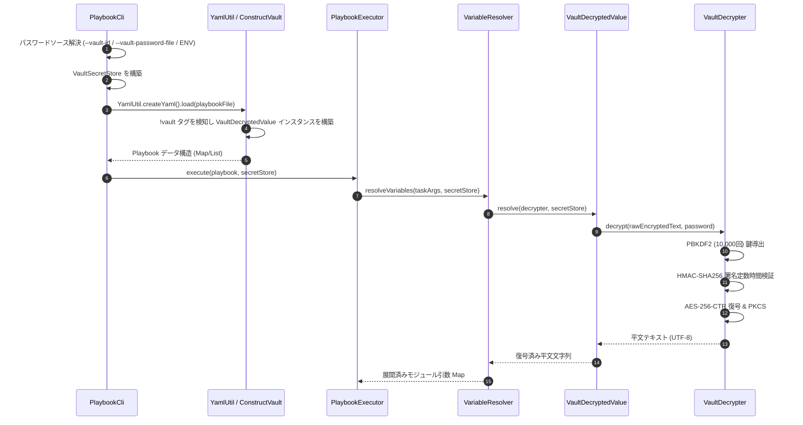

# Ansible Vault 復号・暗号化実装仕様 (Ansible Vault Implementation)

本ドキュメントでは、`graal-ansible` における Ansible Vault 暗号化データ（暗号化ファイルおよびインラインの `!vault` 独自タグ）を Java でネイティブに復号・暗号化し、Playbook 実行エンジンへ透明に統合するための詳細なクラス設計、データ構造、暗号アルゴリズム、および遅延評価ライフサイクルについて定義します。

## 1. 概要 (Overview)

Ansible Vault は、機密情報（パスワード、APIキー、秘密鍵、トークン等）を AES-256-CTR 暗号で保護して Git リポジトリ等に安全に保管する仕組みです。`graal-ansible` では、外部の Python プロセスや GraalPy インタプリタを介さず、Java の標準暗号ライブラリ（`javax.crypto`）を用いてネイティブかつ高速に復号・暗号化処理を実行します。

- **対応 Vault フォーマット**: Vault 1.1 および 1.2（`$ANSIBLE_VAULT;1.1;AES256`, `$ANSIBLE_VAULT;1.2;AES256;vault-id`）。
- **遅延評価 (Lazy Evaluation)**: SnakeYAML 解析時には暗号化データを値オブジェクトとしてパースし、実際の変数評価フェーズで必要になったタイミングで動的に復号します。
- **マルチ Vault ID 対応**: 複数の `--vault-id` / パスワード指定に対応し、ID マッチングおよびフォールバック復号を実現します。

## 2. 暗号・復号アルゴリズムとキー誘導詳細 (Cryptographic Mechanics)

Ansible Vault で使用される標準的な暗号アルゴリズム、ペイロード解析、鍵誘導手順、および PKCS#7 アライメント処理の詳細を以下に定義します。

### 2.1 ヘッダー構造とフォーマット識別
Vault 暗号化テキストは、改行で区切られたヘッダー行で開始されます。

- **1.1 フォーマット**:
  ```text
  $ANSIBLE_VAULT;1.1;AES256
  ```
- **1.2 フォーマット（Vault ID ラベル付き）**:
  ```text
  $ANSIBLE_VAULT;1.2;AES256;dev_vault
  ```

ヘッダー要素はセミコロン（`;`）で分割され、マジック文字列（`$ANSIBLE_VAULT`）、バージョン（`1.1` または `1.2`）、暗号アルゴリズム（`AES256`）、および Vault ID ラベル（1.2 形式のみ）が順番に検証されます。

### 2.2 二重ヘキサ（Outer / Inner Hex）エンコードと 80 文字改行ラップ
ペイロードのシリアライズおよびデコードは、以下の二重ヘキサ構造に従って処理されます。

1. **アウター（外側）ヘキサデコード**:
   - ヘッダー行以降のテキストから全改行文字（`\n`, `\r\n`）および空白を除去し、1 つの連続したヘキサ文字列に結合します。
   - このヘキサ文字列をバイト配列にデコード（16進数 2 文字 -> 1 バイト）すると、UTF-8 エンコードされたインナーテキスト（中間文字列）が得られます。
2. **インナー（内側）テキスト分離**:
   - インナーテキストを改行文字（`\n`）で分割すると、以下の 3 つのヘキサエンコードされたフィールドが抽出されます。
     - **ソルト (Salt)**: 32 バイトのランダム値（64 文字のヘキサ文字列）
     - **HMAC 署名**: 32 バイトの HMAC-SHA256 署名（64 文字のヘキサ文字列）
     - **暗号文 (Ciphertext)**: AES 暗号化データ（偶数長のヘキサ文字列）
3. **アウターヘキサエンコードおよび 80 文字ラップ (暗号化時)**:
   - 暗号化時には、インナーテキスト（`salt_hex + "\n" + hmac_hex + "\n" + cipher_hex`）を UTF-8 バイト列に変換した後、アウターヘキサ文字列へ変換します。
   - 可読性と git diff 互換のため、アウターヘキサ文字列を 80 文字ごとに改行（`\n`）で区切ってフォーマットします。

### 2.3 PBKDF2 鍵誘導 (Key Derivation - PBKDF2WithHmacSHA256)
抽出された 32 バイトのソルトとユーザー指定の Vault パスワードを用いて、**PBKDF2 (Password-Based Key Derivation Function 2)** により 80 バイトのキーを導出します。

- **擬似ランダム関数 (PRF)**: `PBKDF2WithHmacSHA256` (Java `SecretKeyFactory.getInstance("PBKDF2WithHmacSHA256")`)
- **イテレーション数 (c)**: `10,000` 回
- **導出キー長 (dkLen)**: `80` バイト (640 ビット)
- **キーの 3 分割**:
  80 バイトの導出キー配列は、以下のバイト領域へ正確に切り分けられます：

| 領域 | バイトインデックス | 長さ | 用途 |
| :--- | :--- | :--- | :--- |
| **AES 復号鍵 (AES Key)** | `0` ～ `31` | 32 バイト (256 bits) | AES-256 対称暗号鍵 |
| **HMAC 検証鍵 (HMAC Key)** | `32` ～ `63` | 32 バイト (256 bits) | HMAC-SHA256 署名生成・検証鍵 |
| **初期化ベクトル (IV / Counter Nonce)** | `64` ～ `79` | 16 バイト (128 bits) | AES-CTR カウンター初期化ベクトル |

### 2.4 HMAC-SHA256 整合性検証
AES 復号を実行する前に、改ざん検出およびパスワード不一致判定のため HMAC 検証を行います。

- 導出された HMAC 鍵（32 バイト）を使用し、ヘキサデコードされた**生暗号文バイト配列**に対する HMAC-SHA256 署名を計算します (`Mac.getInstance("HmacSHA256")`)。
- 算出された署名バイト配列と、インナーテキストからデコードされた生 HMAC バイト配列を比較します。
- タイミング攻撃（Timing Attack）を防ぐため、比較には定数時間比較 (`MessageDigest.isEqual`) を使用します。
- 署名が一致しない場合、即座に `VaultDecryptionException("HMAC verification failed: Invalid vault password or corrupted data")` をスローし、不正な鍵による AES 復号処理を遮断します。

### 2.5 対称暗号 (AES-256-CTR) および PKCS#7 パディング
- **暗号・復号モード**: `AES/CTR/NoPadding` (`Cipher.getInstance("AES/CTR/NoPadding")`)
  - AES 鍵 (32 bytes) および IV (16 bytes) を用いて、暗号文バイト配列を復号（またはプレーンテキストを暗号化）します。
- **PKCS#7 パディング・アンパディング**:
  - AES-CTR モードは本質的にストリーム暗号動作のためパディングを必要としませんが、Ansible Vault 仕様に従い、プレーンテキストは 16 バイトブロックサイズへ **PKCS#7 方式** でアライメントパディングされます。
  - **アンパディング規則**: 復号後のバイト配列の末尾バイト `N = data[data.length - 1]` (1 <= N <= 16) を読み取り、末尾 `N` バイトがすべて値 `N` であることを確認して除去します。不正なパディング値が検出された場合は例外をスローします。
  - **パディング規則 (暗号化時)**: プレーンテキストの長さ `len` に対し、パディングバイト数 `padLen = 16 - (len % 16)` を計算し、値 `padLen` を持つバイトを末尾に `padLen` 回追加してから AES-CTR 暗号化を行います。

## 3. クラス設計とインターフェース (Class Design and Interfaces)

Java 実行エンジン内における Vault 処理のコアコンポーネント構成です。

### 3.1 復号コアクラス (`VaultDecrypter.java`)
暗号化テキストのパース、PBKDF2 鍵導出、HMAC 検証、および AES-CTR 復号を担当するコアユーティリティです。

```java
package org.example.ansible.vault;

public class VaultDecrypter {
    /**
     * 単一のパスワードを用いて Vault 暗号化データを復号します。
     * @param encryptedRawText $ANSIBLE_VAULT ヘッダーを含む暗号化テキスト
     * @param password 復号用パスワード
     * @return 復号されたプレーンテキスト（UTF-8）
     * @throws VaultDecryptionException パスワード誤り、HMAC不一致、パディング不整合時
     */
    public String decrypt(String encryptedRawText, String password) {
        // 1. ヘッダーの検証と解析 ($ANSIBLE_VAULT;1.1;AES256 等)
        // 2. アウターヘキサデコード -> インナーテキスト取得
        // 3. インナーテキストから Salt (32B), HMAC (32B), Ciphertext を分離
        // 4. PBKDF2WithHmacSHA256 で 80B 鍵導出 (AES Key, HMAC Key, IV)
        // 5. MessageDigest.isEqual による HMAC-SHA256 署名定数時間検証
        // 6. Cipher (AES/CTR/NoPadding) による復号
        // 7. PKCS#7 アンパディングと UTF-8 文字列変換
    }
}
```

### 3.2 暗号化コアクラス (`VaultEncrypter.java`)
プレーンテキストを Ansible Vault 1.1 / 1.2 形式に暗号化するコアユーティリティです。

```java
package org.example.ansible.vault;

public class VaultEncrypter {
    /**
     * プレーンテキストを指定されたパスワードと Vault ID ラベルで暗号化します。
     * @param plainText 暗号化対象のプレーンテキスト
     * @param password 暗号化用パスワード
     * @param vaultId Vault ID ラベル（任意、null の場合は 1.1 形式）
     * @return $ANSIBLE_VAULT ヘッダーおよび 80 文字ラップされた暗号化テキスト
     */
    public String encrypt(String plainText, String password, String vaultId) {
        // 1. SecureRandom による 32 バイト Salt の生成
        // 2. PBKDF2WithHmacSHA256 による 80 バイト鍵導出 (AES Key, HMAC Key, IV)
        // 3. プレーンテキストの PKCS#7 パディング (16 バイトアライメント)
        // 4. Cipher (AES/CTR/NoPadding) による AES-256 暗号化
        // 5. HMAC-SHA256 署名の算出
        // 6. インナーテキストの構築 (Salt_hex + "\n" + HMAC_hex + "\n" + Cipher_hex)
        // 7. UTF-8 バイト列のアウターヘキサ化および 80 文字ごとの改行ラップ
        // 8. $ANSIBLE_VAULT ヘッダーの付加
    }
}
```

### 3.3 複数パスワードストア (`VaultSecretStore.java`)
複数の Vault ID およびデフォルトパスワードを集中管理し、暗号化データのラベルに応じた適切なパスワード解決を提供するコンテナクラスです。

```java
package org.example.ansible.vault;

import java.util.Map;
import java.util.Optional;

public class VaultSecretStore {
    private final Map<String, String> secretsByVaultId; // label -> password
    private final String defaultPassword;

    public VaultSecretStore(Map<String, String> secretsByVaultId, String defaultPassword) {
        this.secretsByVaultId = secretsByVaultId;
        this.defaultPassword = defaultPassword;
    }

    /**
     * 指定された Vault ID ラベルに対応するパスワード、またはデフォルトパスワードを返します。
     */
    public Optional<String> getSecretForVaultId(String vaultId) {
        if (vaultId != null && secretsByVaultId.containsKey(vaultId)) {
            return Optional.of(secretsByVaultId.get(vaultId));
        }
        return Optional.ofNullable(defaultPassword);
    }
}
```

## 4. AST 独自タグ処理と遅延評価ライフサイクル (AST Tag Handling & Lazy Evaluation)

YAML 解析から変数評価までの遅延評価ライフサイクルの設計仕様です。

### 4.1 `ConstructVault` (SnakeYAML `!vault` スカラノードパース)
SnakeYAML の解析フェーズにおいて、`!vault` タグ付きノードが検出された際、即座に復号を実行せず、生の暗号化テキストを保持する値オブジェクトへマッピングします。

- **`YamlUtil.java` でのコンストラクタ登録**:
  ```java
  public class YamlUtil {
      public static Yaml createYaml() {
          Representer representer = new Representer(new DumperOptions());
          LoaderOptions loaderOptions = new LoaderOptions();
          Constructor constructor = new Constructor(loaderOptions);

          // !vault タグのカスタムコンストラクタ登録
          constructor.addConstruct(new Tag("!vault"), new ConstructVault());
          return new Yaml(constructor, representer);
      }

      private static class ConstructVault extends AbstractConstruct {
          @Override
          public Object construct(Node node) {
              ScalarNode scalarNode = (ScalarNode) node;
              String encryptedContent = scalarNode.getValue();
              return new VaultDecryptedValue(encryptedContent);
          }
      }
  }
  ```

### 4.2 遅延評価オブジェクト (`VaultDecryptedValue.java`)
`VaultDecryptedValue` は、未復号の暗号化テキストを保持し、復号済み値のキャッシュ機構を備えた値オブジェクトです。

```java
package org.example.ansible.vault;

public class VaultDecryptedValue {
    private final String rawEncryptedText;
    private String decryptedCache;

    public VaultDecryptedValue(String rawEncryptedText) {
        this.rawEncryptedText = rawEncryptedText;
    }

    public String getRawEncryptedText() {
        return rawEncryptedText;
    }

    public synchronized String resolve(VaultDecrypter decrypter, VaultSecretStore secretStore) {
        if (decryptedCache != null) {
            return decryptedCache;
        }
        // ヘッダー解析から Vault ID ラベルを抽出
        String vaultId = VaultHeaderParser.extractVaultId(rawEncryptedText);
        String password = secretStore.getSecretForVaultId(vaultId)
                .orElseThrow(() -> new VaultPasswordRequiredException("No vault password available for vault ID: " + vaultId));

        this.decryptedCache = decrypter.decrypt(rawEncryptedText, password);
        return this.decryptedCache;
    }
}
```

### 4.3 `VariableResolver` における遅延評価と平文置換
タスク実行直前の変数解決フェーズ（`VariableResolver.resolve`）において、オブジェクト木を再帰的に走査し、`VaultDecryptedValue` インスタンスを発見した際に遅延復号を行います。

1. **型判定**: 解決対象のオブジェクトが `VaultDecryptedValue` のインスタンスであるか判定。
2. **パスワード確認**: `VariableResolver` 内に保持された `VaultSecretStore` または Vault パスワードが存在するか検証。未設定の場合は `VaultPasswordRequiredException` をスロー。
3. **復号実行**: `vaultValue.resolve(decrypter, secretStore)` を呼び出して UTF-8 平文文字列を取得。
4. **置換と伝播**: 復号された平文文字列で元の `VaultDecryptedValue` オブジェクトを置き換え、Jinja2 テンプレート展開やモジュール引数 Map へ提供します。

## 5. パスワード解像と CLI 統合仕様 (Password Resolution & CLI Integration)

コマンドライン引数および環境変数からのパスワード解決優先順位と対話型コンソール処理仕様です。

### 5.1 パスワードソースの解決優先順位 (Resolution Precedence)
複数のパスワード指定オプションが存在する場合、`PlaybookCli` は以下の優先順位（1 が最優先）でパスワードソースを決定・ロードします。

| 順位 | ソース分類 | CLI 引数 / 環境変数 | 記述形式例 |
| :---: | :--- | :--- | :--- |
| **1** | 明示的ファイルパス | `--vault-password-file <path>` | `--vault-password-file /etc/ansible/vault.key` |
| **2** | Vault ID 指定 | `--vault-id <label@source>` | `--vault-id dev@/path/to/key` または `--vault-id dev@prompt` |
| **3** | 対話型パスワード要求 | `--ask-vault-pass` / `--ask-vault-password` | CLI フラグ（コンソールからパスワードを対話入力） |
| **4** | 環境変数パス指定 | `ANSIBLE_VAULT_PASSWORD_FILE` | `export ANSIBLE_VAULT_PASSWORD_FILE=/path/to/vault.key` |

### 5.2 Vault ID 構文解析 (`label@source`)
`--vault-id` 引数が渡された場合、`PlaybookCli` は以下のルールに従って Vault ID ラベルとパスワードソースをパースします：

- **`@` 区切りが存在する場合** (例: `prod@/path/to/key`):
  - `@` の前を Vault ID ラベル (`prod`)、以降をパスワードソース (`/path/to/key`) として分解します。
- **`@` 区切りが存在しない場合** (例: `/path/to/key` または `prompt`):
  - Vault ID ラベルをデフォルト (`"default"`) とし、指定文字列全体をパスワードソースとして扱います。

### 5.3 対話型プロンプト仕様 (`ConsolePromptProvider`)
パスワードソースとして `prompt` が指定された場合、または `--ask-vault-pass` フラグが有効な場合の動作仕様です。

1. `ConsolePromptProvider` は `System.console()` を参照します。
2. ターミナルコンソールが存在する場合 (`System.console() != null`)、`console.readPassword("Vault password: ")` を呼び出して文字エコーなしで安全に入力文字列を取得します。
3. CI/CDパイプラインや非対話環境（`System.console() == null`）で `prompt` が指定された場合は、即座に `VaultException("Vault password source 'prompt' specified but no interactive console is available")` をスローして安全に処理を終了します。
4. ファイルからパスワードを読み込む場合は、`Files.readString(path).trim()` を用いて末尾の改行コード（`\n`, `\r\n`）および前後の空白を自動除去します。

## 6. エンドツーエンド処理シーケンス (End-to-End Sequence)

CLI からのパスワード解決、YAML パースにおける AST 独自タグ登録、遅延評価、およびモジュール引数への展開までの全体フローを以下に示します。



## 7. エラーハンドリングと例外マッピング (Error Handling)

Vault 処理における例外クラス階層と CLI エラーコードマッピング仕様です。

### 7.1 例外クラス構造
- **`AnsibleVaultException`** (基底例外クラス, `RuntimeException` を継承)
  - **`VaultDecryptionException`**: HMAC 署名不一致、パスワード誤り、壊れたパディング等の復号失敗時にスロー。
  - **`VaultHeaderException`**: `$ANSIBLE_VAULT` マジックヘッダーの不在、未サポートのバージョンや暗号アルゴリズム指定時にスロー。
  - **`VaultPasswordRequiredException`**: `!vault` ノードを検出したにもかかわらず、対応する Vault パスワードが提供されていない場合にスロー。

### 7.2 CLI 終了コードとメッセージ出力方針
- **パスワード未指定またはファイル未存在**:
  - エラーメッセージ: `"ERROR! Vault password file not found or prompt unavailable: <path>"`
  - CLI Exit Code: `1` (General Error)
- **HMAC 検証失敗 / パスワード不一致**:
  - エラーメッセージ: `"ERROR! Decryption failed: Invalid vault password or corrupted vault payload"`
  - CLI Exit Code: `1` (General Error)
- **安全保護**:
  - 例外ログおよびスタックトレース出力において、入力された生パスワードや復号された平文機密データがログファイルや標準出力へ漏洩しないよう、マスク処理（`***`）を徹底します。
