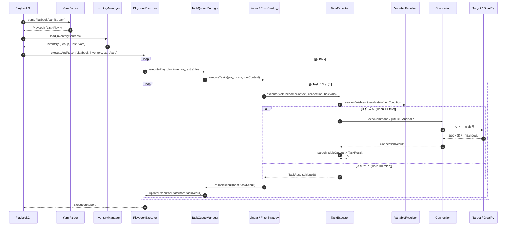
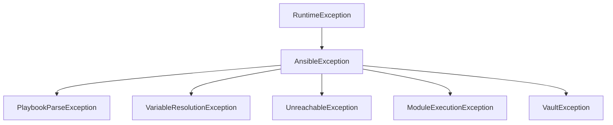

# アーキテクチャ設計 (Architecture Design)

本ドキュメントでは、`ansible-core` の機能を Java 21 および GraalVM Native Image で効率的に実行するためのシステム全体構造、モジュール化されたクリーンなレイヤー設計、データパイプライン、並行実行モデル、および拡張性アーキテクチャについて詳述します。

## 1. 全体アーキテクチャの概要

`graal-ansible` は、Ansible 互換の自動化エンジンを Java ネイティブで再実装した高性能な自動化プラットフォームです。制御ノード（管理ノード）側で実行されるコアエンジン（Playbook 解析、インベントリ解決、変数管理、タスクスケジューリング）を Java 21 で構築しつつ、ターゲットノード上で動作するモジュール実行および制御ノード側での Action Plugin / Inventory Plugin 実行には **GraalPy Polyglot** 環境を活用します。

これにより、以下の設計思想を高い次元で両立させています。

1. **Python-first の互換性**: 既存の膨大な Ansible モジュールやプラグイン資産をそのまま稼働させる。
2. **Native Performance**: Java の高度な並行性プリミティブと GraalVM Native Image による単一バイナリ配布・ミリ秒単位の超高速起動・省メモリフットプリントを実現する。
3. **Clean Architecture**: 関心事の分離（Separation of Concerns）を徹底し、テスタビリティと拡張性を最大化する。

```mermaid
graph TD
    subgraph Control_Node [管理ノード / Control Node (Java 21 / GraalPy)]
        CLI[CLI 層: PlaybookCli] --> Parser[Parser 層: YamlParser]
        CLI --> InvMgr[Inventory 層: InventoryManager]
        Parser --> PE[Execution Engine: PlaybookExecutor]
        InvMgr --> PE
        PE --> TQM[TaskQueueManager]
        TQM --> Strategy{Strategy: Linear / Free}
        Strategy --> Worker[TaskExecutor / Worker]
        Worker --> VM[VariableManager / VariableResolver]
        Worker --> Polyglot[GraalPy Polyglot Context]
        Worker --> ConnFactory[ConnectionFactory]
        ConnFactory --> Conn[Connection Plugins]
        TQM --> Callback[Callback Plugins]
    end

    subgraph Target_Node [ターゲットノード / Target Node]
        Conn -->|Ansiballz / SSH / WinRM / Local / Docker| RemoteTarget[Ansible Module 実行環境]
    end
```

## 2. ディレクトリ・パッケージ構造と責務境界

プロジェクトは標準的な Maven ディレクトリ構造に準拠し、パッケージ間依存は常に上位から下位への単方向依存となるよう設計されています。

### 2.1 パッケージ構造

```
src/main/java/org/example/ansible/
├── Main.java                        # エントリーポイント
├── cli/                             # コマンドライン引数解析 (Picocli 統合)
│   ├── PlaybookCli.java
│   └── ...
├── parser/                          # YAML / Playbook 解析 (SnakeYAML 2.x 統合)
│   ├── YamlParser.java
│   └── YamlUtil.java
├── inventory/                       # インベントリ管理・探索・パターン解析
│   ├── Inventory.java
│   ├── InventoryManager.java
│   ├── InventoryProvider.java
│   ├── FileInventoryProvider.java
│   ├── ScriptInventoryProvider.java
│   ├── PythonInventoryProvider.java
│   ├── HostPatternParser.java
│   └── ...
├── engine/                          # Playbook 実行コアエンジン
│   ├── PlaybookExecutor.java        # Playbook 実行ライフサイクル管理
│   ├── TaskQueueManager.java        # ホストキュー・バッチ・戦略委譲
│   ├── TaskExecutor.java            # 単一タスク実行・ループ・条件評価
│   ├── VariableManager.java         # 22段階変数優先順位マージ
│   ├── VariableResolver.java        # Jinjava テンプレート評価・API提供
│   ├── ExecutionReport.java         # 実行結果詳細統計・フィルタ
│   ├── Strategy.java                # 実行戦略 SPI (Linear / Free)
│   ├── Callback.java                # 出力・イベントフック SPI
│   ├── filter/                      # Ansible 互換 Jinja2 フィルター群
│   └── lookup/                      # Lookup プラグイン群
├── connection/                      # ターゲット接続抽象化
│   ├── Connection.java              # 接続インターフェース
│   ├── ConnectionFactory.java       # 動的接続解決ファクトリ
│   ├── LocalConnection.java         # ローカルプロセス実行
│   ├── SshConnection.java           # Apache MINA SSHD / 多段 Bastion
│   ├── DockerConnection.java        # Docker CLI 実行
│   └── WinRMConnection.java         # WinRM4J Windows 接続
├── module/                          # Python モジュールブリッジ
│   ├── PythonModule.java
│   └── python/                      # GraalPy 起動・初期化ユーティリティ
└── util/                            # OS 抽象化・共通ユーティリティ
    ├── OSHandler.java
    ├── OSHandlerFactory.java
    ├── PythonOSMock.java
    └── Truthiness.java
```

### 2.2 レイヤー別の詳細責務と公開インターフェース

| レイヤー / パッケージ | 主たる責務 | 公開インターフェース / 代表クラス | 依存先レイヤー |
| :--- | :--- | :--- | :--- |
| **CLI 層 (`cli`)** | CLI オプション解析、Level 1 変数展開、終了コード返却 | `PlaybookCli` | `parser`, `engine`, `inventory` |
| **Parser 層 (`parser`)** | YAML 解析、構文検証、タグ変換、不変 Record マッピング | `YamlParser`, `YamlUtil` | `engine` (モデルレコード) |
| **Inventory 層 (`inventory`)** | 静的/動的インベントリ解析、ホストパターン展開、変数収集 | `Inventory`, `InventoryManager`, `InventoryProvider` | `util` |
| **Engine 層 (`engine`)** | タスクスケジューリング、変数評価、Jinja2 テンプレート処理 | `PlaybookExecutor`, `TaskQueueManager`, `TaskExecutor` | `connection`, `module`, `util` |
| **Connection 層 (`connection`)**| ターゲット間通信（コマンド実行、ファイル転送、昇格） | `Connection`, `ConnectionFactory`, `ConnectionResult` | `util` |
| **Module 層 (`module`)** | GraalPy Polyglot 実行、データバインディング、結果 JSON パース | `PythonModule`, `ITaskExecutor` | `connection`, `util` |
| **Util 層 (`util`)** | OS 抽象化、パス正規化、真偽値判定、Python モック | `OSHandler`, `OSHandlerFactory`, `PythonOSMock` | なし (最下層) |

## 3. コンポーネント間データフローとパイプライン

Playbook 実行における全体のデータフローは、厳密に定義された 7 つのフェーズを通じて処理されます。



### 3.1 処理パイプラインのフェーズ詳細

1. **Initialization Phase (CLI & Parser)**:
   - コマンドライン引数をパースし、`-e` (extra-vars)、`-i` (inventory)、`--check`、`--become` 等のグローバル実行オプションを確定します。
   - SnakeYAML 2.x を用いて Playbook YAML を解析し、`Play`, `Block`, `Task` の不変 Java Record 構造へマッピングします。
2. **Inventory Resolution Phase**:
   - `InventoryManager` が指定されたソース（静的 INI/YAML、動的スクリプト、Python プラグイン、ディレクトリ）を識別し、透過的に単一の階層化 `Inventory` レコードへ統合します。
   - `HostPatternParser` により、ブラケットを考慮した範囲展開（`web[01:10]`）とワイルドカード照合を行って対象ホスト一覧を決定します。
3. **Execution Orchestration Phase (PlaybookExecutor & TQM)**:
   - Play レベルのディレクティブ（`serial`, `strategy`, `max_fail_percentage`, `any_errors_fatal`）を検証し、実行戦略（`LinearStrategy` または `FreeStrategy`）を初期化します。
   - 各種コールバックプラグイン（`DefaultCallback`, `JsonCallback` 等）へ Play 開始イベントを発行します。
4. **Task Scheduling & Batching Phase (Strategy)**:
   - `LinearStrategy`: `serial` に従いホスト群をバッチに分割し、全ホストで同期を取りながらタスクをステップ実行します。
   - `FreeStrategy`: `forks` スレッドプールを用い、ホストごとに依存なくタスクを可能な限り最速で並列消化します。
5. **Templating & Dynamic Evaluation Phase (TaskExecutor & VariableResolver)**:
   - 22 段階の優先順位ルールに従ってタスク実行直前の変数を遅延解決します。
   - `when` 条件の評価、`loop` コレクションの展開、`environment` 変数のレンダリング、および `check_mode` の動的判定を行います。
6. **Module Dispatch & Remote Execution Phase**:
   - Action Plugin 対象タスク（`template`, `copy`, `debug` 等）は制御ノード上の GraalPy コンテキストで実行します。
   - リモートモジュール実行タスクは Ansiballz パッケージを構築し、`Connection`（SSH, Docker, WinRM）経由でターゲットへ転送・実行します。
7. **Aggregation & Reporting Phase**:
   - モジュール終了コードおよび標準出力 JSON を `TaskResult` へマッピングし、`register` 変数への登録や `notify` ハンドラーのキューイングを行います。
   - Play 終了後にハンドラーをフラッシュし、最終的な実行統計を `ExecutionReport` に集約して CLI 終了コード（0, 1, 2, 4）を決定します。

## 4. 並行性モデルとスレッド安全性 (Concurrency & Thread Safety)

`graal-ansible` はマルチコア CPU の性能を最大限に引き出すため、高度な並行性制御アーキテクチャを採用しています。

### 4.1 並行実行アーキテクチャマトリクス

| コンポーネント | 採用モデル | スレッドセーフティ機構 | 役割と制御仕様 |
| :--- | :--- | :--- | :--- |
| **`LinearStrategy`** | バッチ分割・同期実行 | 反復ループ同期 + バリア同期 | `serial` 設定に基づくバッチ分割、バッチごとの全ホスト完了同期とハンドラーフラッシュ。 |
| **`FreeStrategy`** | スレッドプール並列実行 | `ThreadPoolExecutor` (固定 `forks` 数) | ホストごとに独立したスレッドを割り当て、他ホストの完了を待たずにタスクパイプラインを先行消化。 |
| **`throttle` 制御** | リソース制限セマフォ | `java.util.concurrent.Semaphore` | 同一タスクまたは Block を同時に実行できる最大ホスト数を動的に制限。 |
| **フェイルセーフ監視** | アトミック状態管理 | `AtomicBoolean`, `AtomicInteger` | `any_errors_fatal` 発火時の全スレッド即時停止、`max_fail_percentage` 閾値超過時の新規タスク投入抑止。 |
| **コールバック出力** | 同期化ストリーム | `synchronized` メソッド | 並列タスク実行時における標準出力ログ（PLAY RECAP 等）の文字混在・競合防止。 |
| **非同期タスク管理** | スケジューリングプール | `ScheduledExecutorService` | `async`/`poll` タスクのバックグラウンド実行およびファイル永続化（`~/.ansible_async/`）。 |

### 4.2 メモリモデルとデータの不変性 (Immutability)

並行実行時のデータ競合を根本から排除するため、設計原則としてデータの不変性を徹底しています。

- **不変モデルレコード**: `Task`, `Play`, `PlayContext`, `BecomeContext` は Java 21 `record` として宣言され、スレッド間で安全に共有可能です。
- **スレッドローカル変数コンテキスト**: タスク評価時の変数マップ（`combinedVars`）は、各ホスト・各タスクの評価ごとに新しくマージ・生成され、呼び出し元の親スコープ変数を汚染しません。

## 5. GraalPy Polyglot 実行基盤アーキテクチャ

Ansible の Python コードを Java プロセス内で高速かつ安全に動作させるための Polyglot 基盤設計です。

```mermaid
graph LR
    subgraph Java_Control_Plane [Java コントロールプレーン]
        TE[TaskExecutor]
        Conn[Connection]
        PR[PythonModule]
    end

    subgraph Polyglot_Boundary [Polyglot 境界 (GraalVM SDK)]
        Context[Polyglot Context (Thread-Safe / Shared)]
        Bindings[Polyglot Bindings: complex_args, connection_java]
    end

    subgraph Python_Runtime [GraalPy ランタイム環境]
        Bridge[ansible_bridge.py (事前ロード & パッチ済)]
        Launcher[ansible_launcher.py / ansible_action_launcher.py]
        ModCode[Ansible Python Module / ActionBase]
    end

    TE -->|putMember| Bindings
    TE -->|eval| Context
    Context --> Launcher
    Launcher --> Bridge
    Bridge --> ModCode
    ModCode -->|run_command / putFile| Conn
    ModCode -->|exit_json| Bridge
    Bridge -->|JSON output| PR
    PR -->|parseModuleOutput| TE
```

### 5.1 Polyglot Context ライフサイクルと共有設計

- **事前ロード (Warm-up)**: `TaskExecutor` の初期化時に `ansible_bridge.py` を 1 度だけ評価・コンパイルして GraalPy 内部にキャッシュします。これにより、タスク実行ごとのスクリプト評価オーバーヘッドを削減します。
- **双方向ブリッジ**: Java の `Connection` オブジェクトを Python コンテキストへ直接バインドし、Python 側の `AnsibleModule.run_command` や `ActionBase._transfer_file` から Java 側のメソッドを透過的に呼び出します。
- **スレッドローカル隔離**: `FreeStrategy` によるマルチスレッド実行時、コレクション探索パスはスレッドローカル変数（`ThreadLocal<List<String>>`）で管理され、タスク完了後の `finally` ブロックで Polyglot Bindings（`complex_args_java` 等）を明示的にクリアしてメモリリークを防ぎます。

## 6. プラグイン・ファクトリ拡張アーキテクチャ

`graal-ansible` は高度な拡張性を備えており、すべての主要コンポーネントがインターフェースとファクトリパターン（SPI）に基づいて疎結合に設計されています。

### 6.1 ファクトリ解決マトリクス

| プラグイン種別 | 抽象インターフェース | ファクトリクラス | 解決キー / 優先順位 | サポート実装 |
| :--- | :--- | :--- | :--- | :--- |
| **接続 (Connection)** | `Connection` | `DefaultConnectionFactory` | `ansible_connection` 変数 (`local`, `ssh`, `docker`, `winrm`) | `LocalConnection`, `SshConnection`, `DockerConnection`, `WinRMConnection` |
| **戦略 (Strategy)** | `Strategy` | `StrategyFactory` | `ANSIBLE_STRATEGY` / Play `strategy` (`linear`, `free`) | `LinearStrategy`, `FreeStrategy` |
| **コールバック (Callback)**| `Callback` | `CallbackFactory` | `ANSIBLE_STDOUT_CALLBACK` / CLI 設定 (`default`, `json`, `yaml`, `minimal`) | `DefaultCallback`, `JsonCallback`, `YamlCallback`, `MinimalCallback`, `PythonCallback` |
| **インベントリ (Inventory)**| `InventoryProvider` | `InventoryManager` | ソース形式の自動判定 (拡張子, `plugin` キー, 実行属性) | `FileInventoryProvider`, `ScriptInventoryProvider`, `PythonInventoryProvider` |
| **Lookup プラグイン** | `Lookup` | `VariableResolver` (内蔵レジストリ) | `lookup('<name>', ...)` の第1引数名 | `file`, `env`, `template`, `pipe`, `dict`, `vars`, `first_found` |
| **Jinja2 フィルター** | `Filter` | `VariableResolver` (Jinjava 登録) | パイプ記法 `\| <name>` (短縮名および FQCN 解決) | 27 種類の組み込みフィルター + FQCN エイリアス解決 |

## 7. レジリエンスとリソースライフサイクル管理

障害発生時の安全な停止、エラー回復、およびリソースリークの防止に関するアーキテクチャ方針です。

### 7.1 例外階層構造 (Exception Hierarchy)

すべての独自例外は `AnsibleException` を頂点とする非検査例外（`RuntimeException`）として設計されており、不要な `throws` 宣言を排除しつつレイヤー間の適切な責務分離を維持します。



### 7.2 エラーリカバリと変数伝播 (`block/rescue/always`)

- **自動変数注入**: タスク失敗時、`TaskQueueManager` は直ちに `ansible_failed_task`（タスク名、アクション情報）および `ansible_failed_result`（モジュール戻り値、エラーメッセージ）を構築し、`rescue` セクションへ透過的に注入します。
- **状態復元**: `rescue` ブロック内のすべてのタスクが正常終了した場合、当該ホストのエラー状態はクリアされ、Playbook 実行を安全に再開できます。

### 7.3 カスケードリソース解放 (Reverse Teardown)

ターゲットノードとの接続や一時ファイルのクリーンアップは、確立時と厳密に逆順で行われます。
- **SSH 踏み台トンネル**: ターゲットセッションの切断 -> ローカルポートフォワーディングの停止 -> 多段踏み台セッション（Bastion 2 -> Bastion 1）の切断。
- **Ansiballz 一時ディレクトリ**: モジュール実行完了時、例外発生の有無にかかわらず `finally` ブロックでターゲットノード上のリモート一時ディレクトリを削除。

## 8. GraalVM Native Image 最適化アーキテクチャ

`graal-ansible` は、スタンドアロンなネイティブバイナリとして配布可能なアーキテクチャを備えています。

### 8.1 Ahead-Of-Time (AOT) コンパイル設計

- **リフレクション構成の最小化**: SnakeYAML や Jackson、Picocli 等のデータバインディング用クラスは、`src/main/resources/META-INF/native-image/org.example/graal-ansible/reflect-config.json` に明示的に定義され、AOT コンパイル時に静的解決されます。
- **リソースバンドル**: `ansible_bridge.py` をはじめとする Python ランチャー群および標準ライブラリモックは `resource-config.json` によりバイナリ内部に直接組み込まれます。
- **超高速起動**: JVM ウォームアップが不要なため、CLI 起動からタスク開始まで数十ミリ秒オーダーの圧倒的なレスポンスを実現します。

## 9. 関連ドキュメント
- [処理フロー：AnsibleのPlaybook読み込みから実行まで](../features/Process-Flow.md)
- [タスク実行エンジン (Task-Executor)](../implementation/Task-Executor.md)
- [ストラテジ・プラグインの実装仕様](../implementation/Strategy-Plugins.md)
- [接続プラグイン実装](../implementation/Connection-Plugins.md)
- [変数とテンプレートの実装詳細](../implementation/Variables-Templating.md)
- [GraalPy 統合の詳細](GraalPy-Integration.md)
- [Native Image 最適化](../implementation/Native-Image-Optimization.md)
