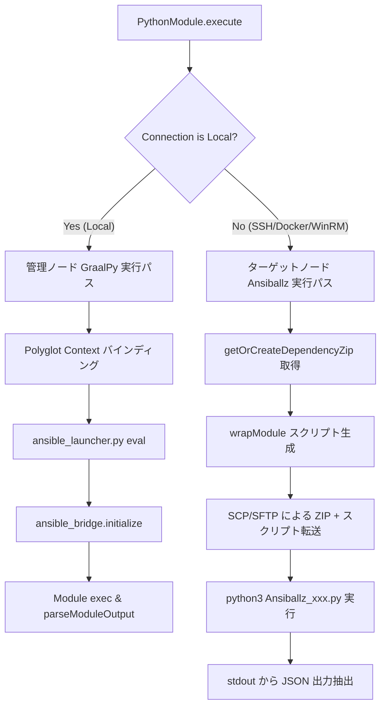

# GraalPy 統合の詳細 (GraalPy Integration Specification)

本プロジェクトでは、本家 Ansible の Python モジュールをそのまま実行するために、GraalVM の Python ランタイムである **GraalPy** を Java エンジンに統合しています。本ドキュメントでは、その統合仕様、コンテキスト設定、Java-Python データバインディング、Polyglot 例外伝播、および互換性維持のためのモンキーパッチ・エミュレーション仕様について詳述します。

## 1. 統合の概要 (Overview)

Ansible モジュールの多くは複雑な Python スクリプトであり、これらを Java で再実装することは膨大な工数と微妙な仕様差異（バグ）のリスクを伴います。`graal-ansible` では、GraalVM SDK の Polyglot API を使用して、Java プロセス内で GraalPy インタプリタを直接制御し、本物の Ansible Python モジュールおよび Action Plugin を実行します。

また、リモートターゲットノード実行時においては、Ansiballz 形式（モジュールコードと依存ライブラリを内包した ZIP パッケージ）を Java 側で動的に構築し、ターゲット上の Python インタプリタへ転送・実行するハイブリッド実行モデルを採用しています。

## 2. GraalVM コンテキスト構成とライフサイクル (Context Configuration & Lifecycle)

安定した実行と高い互換性を確保するため、`TaskExecutor` において以下の Polyglot Context オプションおよびスレッドセーフティ構成を設定しています。

### 2.1 コンテキスト構成オプション

| オプション | 設定値 | 目的・動作詳細 |
| :--- | :--- | :--- |
| `python.IsolateNativeModules` | `true` (Linux) / `false` (Windows) | ネイティブモジュールの分離。Linux 環境では安定動作のため `true`、Windows 環境では JNI/モック相互運用の柔軟性確保のため `false` を適用。 |
| `python.PosixModuleBackend` | `native` (Linux) | POSIX モジュールのバックエンド。Linux 環境では `native` システムコールを使用。 |
| `python.Executable` | (自動検出) | GraalPy 実行バイナリのパス。システムプロパティまたは環境変数から自動解決。 |
| `python.CoreHome` / `python.StdLibHome` | (リソースパス) | Native Image 環境における埋め込み GraalPy 標準ライブラリパス。 |

### 2.2 スレッド分離とライフサイクル管理
- **スレッドセーフティ**: GraalVM Polyglot Context はスレッド共有に制約があるため、`FreeStrategy` 等のマルチスレッド並列実行時においては、スレッドローカルなコレクション検索パス管理（`ThreadLocal<List<String>>`）およびタスク単位のバインディング初期化・破棄を行います。
- **バインディングの解放**: 各タスク実行完了時（`finally` ブロック）に、`context.getBindings("python").removeMember(...)` により注入された Java オブジェクト（`complex_args_java`, `connection_java` 等）への参照を破棄し、メモリリークおよびタスク間の状態汚染（State Pollution）を防止します。

## 3. Java-Python データバインディング仕様 (Data Binding Matrix)

`PythonModule.java` および `TaskExecutor.java` から GraalVM Context の bindings へ注入されるメンバー変数の一覧と、Python 側でのデータ変換規則です。

### 3.1 バインディング引数マトリクス

| 変数名 | Java 型 | Python 受信型 | 役割・説明 |
| :--- | :--- | :--- | :--- |
| `complex_args_java` | `Map<String, Object>` | `dict` | モジュールへ渡される入力引数（タスク定義の `args`）。`_deep_convert` によりネイティブ辞書に再帰変換。 |
| `module_name` | `String` | `str` | 実行対象モジュールの名称（例: `ansible.builtin.ping`, `copy`）。 |
| `site_packages_java` | `List<String>` | `list[str]` | `ansible-core` 等が配置されている `target/python-packages` ディレクトリのパスリスト。 |
| `collection_paths_java` | `List<String>` | `list[str]` | Playbook またはタスクから指定されたコレクション探索パス。 |
| `connection_java` | `Connection` | Java Proxy | ターゲットノードへの接続オブジェクト（`execCommand`, `putFile`, `fetchFile` を提供）。 |
| `become_context_java` | `BecomeContext` | Java Proxy | 権限昇格コンテキスト（`sudo`, `su`, パスワード等）。 |
| `environment_java` | `Map<String, String>` | `dict` | タスクレベルで評価された環境変数。`os.environ` へ一時マージ。 |
| `module_code` | `String` | `str` | モック・レガシー実行モード時に渡されるインライン Python スクリプトコード。 |

### 3.2 データ再帰変換アルゴリズム (`_deep_convert`)
Python 側の `ansible_bridge._deep_convert(obj)` は、Java の Proxy オブジェクトを以下の規則に従って Python ネイティブ型へと安全に再帰変換します。
- `java.util.Map` -> Python `dict`（キー文字列化、値の再帰変換）
- `java.util.List` / `java.util.Set` -> Python `list`
- `java.lang.String` -> Python `str`（Windows パス等のスラッシュ正規化 `_normalize_path` を適用）
- `java.lang.Boolean` -> Python `bool`
- `java.lang.Integer`, `Long`, `Short`, `Byte` -> Python `int`
- `java.lang.Float`, `Double` -> Python `float`
- `java.nio.file.Path`, `java.io.File` -> 正規化済み絶対パス文字列

## 4. モジュール実行モデル (Execution Paths)

`PythonModule.java` は、タスクの接続方式（`Connection`）に応じて以下の 2 つの実行パスを動的に切り替えます。

### 4.1 管理ノード GraalPy 実行パス (Local Execution)
1. `TaskExecutor` のコンストラクタにて共通ブリッジスクリプト `ansible_bridge.py` を事前ロード。
2. `PythonModule` がバインディング引数を GraalVM Context にセット。
3. `ansible_launcher.py` を評価（eval）。
4. `ansible_bridge.initialize()` を呼び出し、`sys.path` 設定、環境変数マージ、およびモンキーパッチを適用。
5. モジュールコードをロードし、`sys.modules['__main__']` スコープで `exec()` 実行。
6. 標準出力または Python 戻り値から JSON 文字列を抽出し、`TaskResult` へパース。

### 4.2 ターゲットノード Ansiballz 実行パス (Remote Execution)
1. 実行対象モジュールの Python ソースファイルを探索・特定。
2. `getOrCreateDependencyZip()` を呼び出し、`ansible.module_utils` や依存パッケージを含む `ansible_lib.zip` を生成・キャッシュ。
3. `wrapModule()` により、Base64 エンコードされたモジュールコードと引数 JSON、`patched_dumps`、および ZIP 解凍・インポートラッパーを含む自己完結スクリプト（`Ansiballz_<module>.py`）を構築。
4. ターゲットノード上にテンポラリディレクトリ（`/tmp/ansible.<uuid>`）を作成。
5. `ansible_lib.zip` と `Ansiballz_<module>.py` をターゲットノードへ転送。
6. ターゲット上の Python インタプリタ（`python3`）でスクリプトを実行。
7. 実行結果 JSON を標準出力から回収し、テンポラリディレクトリを削除クリーンアップ。

## 5. モンキーパッチとエミュレーション仕様 (Dependency Emulation Strategy)

GraalPy 上での実行時に発生するネイティブ依存関係や循環参照を回避するため、`ansible_bridge.py` において以下のパッチ・エミュレーションを適用しています。

### 5.1 システムモジュールおよび外部ライブラリのエミュレーション
- **`ansible.utils.display`**: `Display` クラスをスタブ化し、端末制御（`termios`）への不要な依存を遮断しつつ Java ロガーへ統合。
- **`grp`, `pwd`**: POSIX ユーザー/グループ情報を返すスタブを `sys.modules` に直接注入。
- **`termios`**: 端末制御関連の定数とメソッドをスタブ化。
- **`cryptography`, `selinux`**: ネイティブ C 拡張への依存を回避するため、`sys.modules` に `None` またはモックを注入。

### 5.2 `AnsibleModule` 内部メソッドのパッチ
- **`_load_params`**: 通常は標準入力から読み取る引数を、Java から渡された `complex_args` を直接参照するよう上書き。
- **`run_command`**: コマンド実行を Java の `Connection` オブジェクトへ委譲し、SSH や Docker 等のターゲット実行を透過的に処理。また、`getent` コマンドに対するエミュレーション応答を提供。
- **`get_bin_path`**: システム探索オーバーヘッドを削減するため、`/usr/bin/` などの主要パスを優先返却。
- **`_record_module_result`**: モジュール実行完了時の結果辞書を JSON シリアライズして記録。

### 5.3 JSON エンコーダーの拡張 (`AnsibleEncoder` & `patched_dumps`)
モジュールが返却する `bytes`, `bytearray`, `set`, `frozenset`, `range`, `Exception`, `WrappedValue` 等の非標準型を自動的に UTF-8 文字列やリスト、辞書へ変換するカスタムシリアライザを適用します。

## 6. 例外伝播と出力解析仕様 (Exception Propagation & Output Parsing)

GraalPy と Java 間の例外キャプチャおよび出力抽出メカニズムです。

### 6.1 `SystemExit` および Python 例外の捕捉
- **`SystemExit(0)` / `exit_json()`**: モジュールが正常終了した場合、GraalPy は `PolyglotException` を送出します。Java 側は `e.isExit()` かつ `e.getExitStatus() == 0` を判定し、標準出力に記録された JSON の解析へ進みます。
- **`SystemExit(1)` / `fail_json()`**: 異常終了時は `failed: true` を含む JSON が出力され、`TaskResult.failure(msg, resultMap)` として復元されます。
- **未補足例外 (Unhandled Exceptions)**: `ansible_bridge.py` の例外捕捉ブロックがトレースバックを抽出し、`{"failed": true, "msg": "...", "traceback": "..."}` 形式の JSON を生成して Java へ返却します。

### 6.2 JSON 抽出アルゴリズム (`parseModuleOutput`)
モジュール出力には、Python 警告文やデバッグ出力が混入する場合があります。`PythonModule.parseModuleOutput` は以下の優先順位で有効な JSON オブジェクトを抽出します。
1. 出力文字列を行ごとに末尾から走査し、`{` と `}` を含む最新行を探索。
2. 見つかった行の最初に出現する `{` から最後に出現する `}` までの部分文字列を抽出。
3. 行単位で発見できない場合は、出力全体の中で最初の `{` と最後の `}` の間をフォールバック抽出。
4. 抽出された文字列を Jackson `ObjectMapper` により `Map<String, Object>` へ変換。

## 7. 関連ドキュメント
- [アーキテクチャ設計](Architecture.md)
- [エラーハンドリング方針](Error-Handling-Policy.md)
- [リモートノードでのモジュール実行仕様](../implementation/Remote-Module-Execution.md)
- [Ansible モジュールの初期化と設定](../implementation/Ansible-Module-Initialization.md)
- [Action Plugin / Module Mock 実装リファレンス](../implementation/Mock-Implementation-Reference.md)
